<!-- SPDX-License-Identifier: GPL-3.0-or-later -->
<!-- Copyright (C) 2026 PiTrac contributors -->

# Light-Sheet Optical Trigger: Theory of Operation, Modulation/Demodulation, and Ball Speed Estimation

This document explains the physical, analog, and digital signal-processing theory behind the **modulated infrared (IR) light-sheet trigger** on the **Next Gen PiTrac** controller board, from photon emission through synchronous lock-in demodulation, baseline management, ball detection, and pre-capture velocity estimation.

> **Companion documents in this repository:**
> - **Netlist-extracted component values and derived poles:** [`HARDWARE_REFERENCE.md`](HARDWARE_REFERENCE.md) (§5–§6)
> - **Original board overview and firmware schedule math:** [original hardware design doc](Hardware/The_One_Board_To_Rule_Them_All.md) (§4, §13)
> - **Bench procedures and empirical proofs:** [`Hardware/firmware/BENCH_P2_BEAM.md`](Hardware/firmware/BENCH_P2_BEAM.md) and [`Hardware/firmware/BENCH_P3_DETECT.md`](Hardware/firmware/BENCH_P3_DETECT.md)
> - **Firmware implementations:** [`beam.h`](Hardware/firmware/src/beam.h), [`cal.h`](Hardware/firmware/src/cal.h), [`detect.h`](Hardware/firmware/src/detect.h), and [`detect.pio`](Hardware/firmware/src/detect.pio)

---

## Contents

1. [Why an Active Modulated Light Sheet?](#1-why-an-active-modulated-light-sheet)
2. [Optical and Spatial Geometry](#2-optical-and-spatial-geometry)
3. [End-to-End Signal Chain Overview](#3-end-to-end-signal-chain-overview)
4. [Carrier Modulation (Transmitter)](#4-carrier-modulation-transmitter)
5. [Photodiode Front End: TIA and Active DC Servo](#5-photodiode-front-end-tia-and-active-dc-servo)
6. [Synchronous (Lock-In) Demodulation](#6-synchronous-lock-in-demodulation)
7. [Envelope Recovery and the Gated Baseline HPF](#7-envelope-recovery-and-the-gated-baseline-hpf)
8. [Ball Detection and Speed Estimation](#8-ball-detection-and-speed-estimation)
9. [How Estimated Speed Drives Camera and Strobe Timing](#9-how-estimated-speed-drives-camera-and-strobe-timing)
10. [Real-World Hardware Constraints on Rev V1](#10-real-world-hardware-constraints-on-rev-v1)

---

## 1. Why an Active Modulated Light Sheet?

A photometric golf launch monitor needs two pieces of information **within microseconds of launch**, before the ball flies out of the camera field of view (FOV):

1. **An immediate, deterministic trigger** ($t_0$) proving a ball has launched.
2. **An immediate estimate of ball speed** ($v$) so the strobe burst can space its ~10 flashes ~1–2 ball diameters apart and size each flash width for $\le 1\text{ mm}$ motion blur, whether the shot is a $2\text{ m/s}$ putt or a $90\text{ m/s}$ drive.

A simple unmodulated IR photogate or DC photodiode fails in real golf environments for three reasons:

- **Steady ambient light (sunlight, simulator projector, room lamps)** creates microamps of DC photocurrent that saturate a high-gain transimpedance amplifier (TIA).
- **Mains lighting flicker ($100/120\text{ Hz}$ and harmonics from rectified LED drivers)** sits directly inside the frequency band of a golf-ball transit ($50\text{ Hz}\text{–}5\text{ kHz}$) and looks indistinguishable from a ball.
- **Static optical background (reflection off the hitting mat, floor, or lens crosstalk) and LED thermal drift** shift the DC baseline continuously, moving a fixed comparator threshold out of alignment.

PiTrac V2 solves all three problems simultaneously using **carrier-modulated reflection optics** paired with an analog **synchronous (lock-in) demodulator** and a **gated high-pass baseline servo**:

| Interferer | How the light-sheet chain rejects it |
|---|---|
| Steady sunlight / DC room light | **Active $2.27\text{ Hz}$ DC servo** at the TIA summing node cancels steady photocurrent before amplification |
| $100/120\text{ Hz}$ room-light flicker & projector ripple | **$104.17\text{ kHz}$ synchronous demodulator** up-converts unmodulated light to $104\text{ kHz}$, where the $15.39\text{ kHz}$ 4th-order LPF crushes it ($\approx 48\text{ dB}$ measured rejection) |
| Static mat/floor reflection, optical crosstalk & LED warm-up drift | **Gated $0.66\text{ s}$ baseline HPF** continuously zeroes static carrier return while idle (`TRACK`), then freezes that reference (`HOLD`) while armed so slow putts are not attenuated |

---

## 2. Optical and Spatial Geometry

### Reflection-Mode Curtain (Single-Sided Hardware)

Rather than placing an emitter on one side of the hitting area and a break-beam receiver tower on the far side (where a club or shanked ball could strike it), PiTrac V2 uses a **single-sided retro-reflective/backscatter geometry**:

- High-power $850\text{ nm}$ IR LED **`D11` (`VSMA1085250X02`)** and PIN photodiode **`D12` (`VBPW34FAS`)** sit side by side on the PCB behind cylindrical plano-convex optics (such as a 1-inch acrylic half-rod).
- A cylindrical lens focuses strongly along the **downrange ($x$) axis** while leaving light diverging vertically ($y$), projecting both the emitted beam and the photodiode's field of view into a **coincident, thin vertical curtain ("light sheet")** just downrange of the tee.

```
         Top View (looking down at hitting mat)

         /------------------------------------------------------------------\
        /        Shared Stereo Camera FOV (encloses tee + flight!)           \
       /                                                                      \
      |     Tee          |<- w_beam ->|                                        |
      |    (seen in      |  IR Light  |      Multi-Strobe Flight Freezes       |
      |    preview)      |   Sheet    |                                        |
      |       O  =======>|     ||     |=====>  O     O     O     O     O       |
      |    (ball, D)  v  |     ||     |                                        |
       \                 |     ^^     |                                       /
        \                |    /  \    | modulated 104.17 kHz IR              /
         \               +------------+          \                          /
          \              | D11    D12 |           \                        /
           \             +------------+            \                      /
            \          V2 PCB + Cyl. Lens           \                    /
             \                                       \                  /
              +---[ Mira220 Cam 0 ]-------------------+--[ Mira220 Cam 1 ]---+
```

### Spatial Convolution as a Ball Crosses the Sheet

Let the light sheet's two-way sensitivity profile along the downrange flight axis $x$ be $W(x)$ with effective width $w_{\text{beam}}$, and let the golf ball of diameter $D_{\text{ball}} = 42.67\text{ mm}$ have a projected IR backscatter profile $B(x - vt)$ as its center moves along $x$ at speed $v$.

The instantaneous reflected optical power reaching `D12` is the spatial cross-correlation of the ball with the sheet:

$$P_{\text{ball}}(t) = R_{\text{ball}} \int_{-\infty}^{+\infty} W(x)\, B(x - vt)\, dx$$

where $R_{\text{ball}}$ captures the ball's surface reflectance and solid-angle collection efficiency (scaling as $\sim 1/r^2\text{ to }1/r^4$ with board-to-ball range $r$).

- **Before the ball enters the sheet:** $P_{\text{rx}}(t) = P_{\text{bg}}$ (constant optical crosstalk + static background return).
- **While the ball crosses the sheet:** $P_{\text{rx}}(t) = P_{\text{bg}} + P_{\text{ball}}(t)$ traces a **smooth, single-peaked positive bump** whose duration scales strictly as $1/v$ and whose height scales with $R_{\text{ball}}$.

---

## 3. End-to-End Signal Chain Overview

```mermaid
flowchart LR
    PWM1["GPIO31 Carrier PWM<br/>104.167 kHz, D = 25%"] --> U9["U9 74LVC1G123<br/>One-Shot <= 122.7 us"]
    U9 --> TX["U10 + Q11 -> D11<br/>~3 A Peak IR Sheet"]
    TX -.->|"Reflected IR<br/>P_bg + P_ball(t)"| D12["D12 Photodiode<br/>36 V Reverse Bias"]
    D12 --> TIA["U11A Inverting TIA<br/>+ 2.27 Hz DC Servo (TP7)"]
    TIA --> DEM["U13 TMUX1219 + U12A<br/>Sign-Switching Demod (TP10)"]
    PWM2["GPIO39 Demod PWM<br/>104.167 kHz, 50%<br/>Phase-Locked"] --> DEM
    DEM --> LPF["U12D + U12C<br/>4th-Order LPF<br/>15.39 kHz, x2 (TP9)"]
    LPF --> HPF["C81 + U14 TMUX1219<br/>Gated HPF (GPIO33)<br/>TRACK 0.66 s / HOLD"]
    HPF --> GAIN["U12B Non-Inverting<br/>Gain x14.5 (R98 opt.)"]
    GAIN --> CMP["U15 LM393 Comparator<br/>vs Threshold_DC (TP8)"]
    CMP --> PIO["GPIO46 -> PIO2 SM0<br/>1 us Transit Timer"]
    GAIN --> ADC["R102/D14 -> ADC5<br/>250 ksps DMA Ring<br/>50% FWHM Refinement"]
```



| Stage | Key Components | Operating Point / Corner | Role in Theory |
|---|---|---|---|
| **Carrier TX** | `GPIO31` (PWM 7B) → `U9` → `U10` → `Q11` → `D11` | $f_c = 104.1667\text{ kHz}$, $D = 25\%$, $\sim 3\text{ A}$ peak | Tags the light sheet at a known carrier frequency $f_c$ |
| **Photodiode + TIA** | `D12` ($36\text{ V}$ bias), `U11A` (`OPA4323`) | Stock: $R_f = 470\text{ k}\Omega$, $C_f = 0.5\text{ pF}$ ($f_p = 677\text{ kHz}$)<br/>Rework: $R_f \approx 116\text{–}120\text{ k}\Omega$, $C_f \approx 1\text{–}1.5\text{ pF}$ | Converts photocurrent $i_{\text{pd}}(t)$ to voltage centered on virtual ground (`+2V5`) |
| **Active DC Servo** | `U11B` integrator + `U11D` inverter → `R78` | $f_{\text{servo}} = 2.27\text{ Hz}$ stock ($0.56\text{ Hz}$ at $116\text{ k}\Omega$) | Sinks steady ambient DC photocurrent so `U11A` never rails in bright light |
| **Lock-In Mixer** | `U13` (`TMUX1219`) + `U12A`, clocked by `GPIO39` (PWM 11B) | $\pm 1$ gain switching at $f_c$, $50\%$ duty, $6.67\text{ ns}$ phase step | Shifts $f_c$-modulated ball signal to DC; shifts unmodulated ambient light up to $f_c$ |
| **Reconstruction LPF** | `U12D` ($Q_1 = 0.5$) + `U12C` ($Q_2 = 1.0$, gain $\times 2$) | 4th-order Sallen-Key, $f_0 = 15.39\text{ kHz}$, delay $\approx 30\ \mu\text{s}$ | Removes $104\text{ kHz}$ carrier ($-64\text{ dB}$) and up-converted ambient noise; recovers envelope |
| **Gated Baseline HPF** | `C81` ($330\text{ nF}$) + `R96` ($2\text{ M}\Omega$) + `U14` (`TMUX1219`) | `TRACK`: $\tau = 0.66\text{ s}$ ($0.241\text{ Hz}$)<br/>`HOLD`: open circuit | Zeroes static optical return when idle; freezes baseline when armed for slow balls |
| **Post-Amp & Taps** | `U12B` ($\times 14.5$, `R98` tunable), `U15` (`LM393`), `ADC5` | Ground-referenced ($0\text{ V}$ idle); `PIO2` at $1\text{ MHz}$, `ADC5` at $250\text{ ksps}$ | Comparator provides $\sim 1\ \mu\text{s}$ edge trigger; `ADC5` provides reflectance-free width |

---

## 4. Carrier Modulation (Transmitter)

### Why $104.1667\text{ kHz}$ at $25\%$ Duty?

At the RP2354B's $f_{\text{sys}} = 150\text{ MHz}$ system clock, setting PWM slice 7B's wrap register to $\text{TOP} = 1439$ (period $= 1440$ clocks, divider $= 1$) yields:

$$f_c = \frac{150\text{ MHz}}{1440} = 104{,}166.\overline{6}\text{ Hz} \quad \left(T_c = 9.600\ \mu\text{s},\ \ 1\text{ tick} = 6.67\text{ ns} = 0.25^\circ\right)$$

This carrier frequency sits in a deliberate spectral sweet spot:

1. **Far above baseband ball dynamics and lighting flicker:** Even a $100\text{ m/s}$ ($224\text{ mph}$) drive crossing a $\sim 45\text{ mm}$ interaction zone takes $\sim 450\ \mu\text{s}$, placing its spectral energy below a few kilohertz. A $15.39\text{ kHz}$ 4th-order LPF passes the ball envelope cleanly while providing $\sim 64\text{ dB}$ of carrier rejection at $104\text{ kHz}$.
2. **Well inside the TIA bandwidth:** At $104.17\text{ kHz}$, the TIA introduces only $8.7^\circ$ of phase lag on a stock $470\text{ k}\Omega / 0.5\text{ pF}$ board ($4.3^\circ$ on a $116\text{ k}\Omega / 0.99\text{ pF}$ reworked board), preserving pulse amplitude and clean edges.
3. **Pulsed peak-power advantage at $D = 25\%$:** Driving `D11` through dual series $0.27\ \Omega$ ballast resistors ($0.54\ \Omega$ total) from $+5\text{ V}$ produces $\sim 3\text{ A}$ peak current pulses ($2.4\ \mu\text{s}$ ON, $7.2\ \mu\text{s}$ OFF) while holding average thermal dissipation within the emitter's junction limit (`CR-12` caps continuous duty at $25\%$ operating / $35\%$ ceiling).

### Hardware Monostable Protection (`U9`)

The MCU never drives the beam MOSFET `Q11` directly. `Modulation_PWM` passes through **`U9` (`74LVC1G123`)**, a retriggerable monostable wired so a rising edge starts the pulse, a falling edge clears it immediately (`~CLR`), and an internal $R_{68} C_{57}$ timer unconditionally terminates any pulse after **$\approx 122.7\ \mu\text{s}$** if `Modulation_PWM` ever sticks high. A DC beam mode cannot physically exist.

---

## 5. Photodiode Front End: TIA and Active DC Servo

### Reverse-Biased PIN Photodiode (`D12`)

Photodiode `D12` (`VBPW34FAS`, daylight-blocking package peaked near $850\text{ nm}$) has its cathode biased at **$36\text{ V}$ (`VIR` via `R77`)** and its anode held at virtual ground (`+2V5`, $\approx 2.59\text{ V}$) by `U11A`. The $\sim 33.4\text{ V}$ reverse bias widens the PIN depletion region, minimizing junction capacitance $C_j$ so that:
- Photocarrier transit speed is maximized.
- Input noise gain $1 + C_{\text{in}}/C_f$ stays low, allowing sub-picofarad feedback capacitance ($C_f$) with high transimpedance bandwidth:

$$f_{p,\text{TIA}} = \frac{1}{2\pi R_f C_f} \approx \begin{cases} 677\text{ kHz} & (R_f = 470\text{ k}\Omega,\ C_f = 0.5\text{ pF stock}) \\ 1.39\text{ MHz} & (R_f = 116\text{ k}\Omega,\ C_f = 0.99\text{ pF reworked}) \end{cases}$$

### Active DC Servo (`U11B` + `U11D`)

Total photodiode current is the sum of ambient light $i_{\text{amb}}(t)$ and the carrier-modulated return:

$$i_{\text{pd}}(t) = \underbrace{I_{\text{DC}} + i_{\text{flicker}}(t)}_{\text{ambient light}} + \underbrace{\bigl[I_{\text{bg}} + i_{\text{ball}}(t)\bigr]\cdot p_D(t - \tau_d)}_{\text{modulated IR return at } f_c}$$

where $p_D(t) \in \{0, 1\}$ is the duty-$D$ carrier pulse train and $\tau_d$ is the propagation delay.

Without DC cancellation, just $6\ \mu\text{A}$ of steady sunlight or bright indoor lighting across $R_f = 470\text{ k}\Omega$ would shift `U11A`'s output by $2.82\text{ V}$ and clip it hard against the rail. Instead, `U11B` integrates `(V_TIA - V_2V5)` (`R83` $= 1\text{ M}\Omega$, `C73` $= 330\text{ nF}$) and `U11D` inverts and injects a cancelling current back into the summing node through `R78` ($100\text{ k}\Omega$). This forms a high-pass pole at:

$$f_{\text{servo}} = \frac{1}{2\pi R_{83} C_{73}} \cdot \frac{R_f}{R_{78}} \approx 2.27\text{ Hz}\ \text{(stock)}$$

- **For $f \ll f_{\text{servo}}$ (DC sunlight/lamps):** The servo sinks $I_{\text{DC}}$ (plus the DC average $D \cdot I_{\text{bg}}$ of the carrier), pinning quiescent `TP7` (`TIA_Out`) precisely at virtual ground (`+2V5` $\approx 2.59\text{ V}$) up to $\pm 25\ \mu\text{A}$ of ambient photocurrent.
- **For $f = f_c = 104.17\text{ kHz}$:** The servo is five decades below the carrier and completely transparent; `U11A` amplifies the AC carrier swings by $-R_f$.

---

## 6. Synchronous (Lock-In) Demodulation

### How the Sign-Switching ("Chopper") Mixer Works

`U13` (`TMUX1219` analog SPDT switch) and `U12A` (`OPA4323`, with $R_{95} = R_{97} = 10\text{ k}\Omega$) form a classic **balanced sign-switching demodulator** referenced to `+2V5`:

- When `Demodulation_PWM` (`GPIO39`) selects the non-inverting path, `U12A` acts as a **gain $+1$ follower**: $v_{\text{demod}} - V_{2\text{V}5} = +(v_{\text{TIA}} - V_{2\text{V}5})$.
- When `Demodulation_PWM` flips `U13`, `U12A`'s non-inverting input ties to `+2V5` and it acts as a **gain $-1$ inverter**: $v_{\text{demod}} - V_{2\text{V}5} = -(v_{\text{TIA}} - V_{2\text{V}5})$.

In signals measured relative to `+2V5`, the demodulator multiplies its input by a $50\%$ duty bipolar square wave $m(t) \in \{+1, -1\}$ running at $f_c = 104.17\text{ kHz}$, whose Fourier expansion contains **only odd harmonics**:

$$m(t) = \frac{4}{\pi}\sum_{k=0}^{\infty} \frac{1}{2k+1}\sin\!\bigl((2k+1)\omega_c t\bigr) = \frac{4}{\pi}\left(\sin\omega_c t + \frac{1}{3}\sin 3\omega_c t + \frac{1}{5}\sin 5\omega_c t + \cdots\right)$$

### Frequency-Domain View: Why Flicker Vanishes and the Ball Survives

Consider what multiplying by $m(t)$ and passing through the $15.39\text{ kHz}$ low-pass filter (`LPF`) does to each component at `TP7`:

1. **Modulated ball + background return at $f_c$:**
   The ball envelope $A(t) = R_f \bigl[I_{\text{bg}} + i_{\text{ball}}(t)\bigr]$ rides on the carrier $f_c$. Multiplying $\cos(\omega_c t - \Delta\phi)$ by $\sin/\cos(\omega_c t)$ produces a **sum frequency at $2f_c \approx 208\text{ kHz}$** (removed by the LPF) and a **difference frequency at $0\text{ Hz}$ (baseband)**:
   $$v_{\text{LPF}}(t) \propto A(t) \cdot R(\Delta\phi)$$
   The ball's millisecond transit envelope is recovered cleanly at baseband!

2. **$100/120\text{ Hz}$ room-light flicker (passed by the $2.27\text{ Hz}$ TIA servo):**
   Unmodulated flicker $v_{\text{flicker}}(t)$ sits near $120\text{ Hz}$. Multiplying it by $m(t)$ **up-converts** all of its energy to sidebands around $f_c \pm 120\text{ Hz}$, $3f_c \pm 120\text{ Hz}$, etc. ($\ge 104\text{ kHz}$). None of it remains in the $0\text{–}15.39\text{ kHz}$ passband, so the 4th-order LPF attenuates it by $\sim 64\text{ dB}$ in theory ($\approx 48\text{ dB}$ / $250\times$ measured on the bench under rectified LED lighting).

3. **High-frequency interferers (switching supplies, electronic ballasts):**
   Because $m(t)$ contains odd harmonics $(2k+1)f_c$, only external interference landing inside the narrow passband windows $(2k+1)f_c \pm 15.39\text{ kHz}$ ($n = 1, 3, 5, \dots$) can mix down into baseband. Even harmonics ($2f_c, 4f_c, \dots$) are rejected structurally because $m(t)$ has $50.0\%$ duty.

### Exact Phase-Correlation Shape (Trapezoid, Not Cosine)

Because the transmitted optical pulse is a **duty-$D$ rectangle** ($D = 0.25$) rather than a pure sine wave, sliding the $50\%$ $\pm 1$ demodulator clock across phase $\phi \in [0, T_c)$ produces the cross-correlation of a width-$DT_c$ pulse with a width-$0.5T_c$ bipolar square wave — which is a **symmetric trapezoid**:

```
  Demodulated Output vs. Phase Offset (for D = 25%)

   +D*dV |      _________          <- flat plateau of width (0.5 - D)*T_c = 2.4 us (90 deg)
         |     /         \
       0 |----/-----------\-----------/----  <- quadrature nulls (90 deg from peak center)
         |                 \         /
   -D*dV |                  \_______/
         +----+-----+-----+-----+-----+---> Phase (0 to 360 deg = 0 to 1440 ticks)
              0    90   180   270   360
```

From the two Fourier series ([`cal.h`](Hardware/firmware/src/cal.h)), the true plateau peak is $V_{\text{peak}} = D \cdot \Delta V_{\text{TIA}}$ and the $n$-th phase-sweep harmonic is:

$$R_n = \begin{cases} \dfrac{4 D \Delta V_{\text{TIA}}}{n\pi}\operatorname{sinc}(nD), & n = 1, 3, 5, \dots \\[6pt] 0, & n\text{ even} \end{cases} \qquad \text{where }\operatorname{sinc}(x) = \frac{\sin(\pi x)}{\pi x}$$

At the operating duty $D = 0.25$:
- **Even harmonics vanish identically:** $h_2 / h_1 = 0$ for any undistorted input.
- **Intrinsic 3rd harmonic:** $h_3 / h_1 = \left|\frac{\operatorname{sinc}(0.75)}{3\operatorname{sinc}(0.25)}\right| = \frac{1}{9} \approx 0.1111$ (whereas hard clipping toward a square wave drives $h_3 / h_1 \to 1/3 \approx 0.333$).
- **Fundamental-to-peak form factor:** $R_1 / V_{\text{peak}} = \frac{4\operatorname{sinc}(0.25)}{\pi} \approx 1.146$.
- **Quadrature null & sign inversion:** At $90^\circ$ off optimal phase, the $+1$ and $-1$ demodulator windows split every optical pulse equally in half and the output collapses to **zero**; at $180^\circ$ off phase, a ball crossing produces a **negative** pulse instead of a positive one.

### Hardware Phase Lock and Calibration (`cal demod`)

To keep the carrier (`GPIO31`, PWM slice 7B) and demodulator (`GPIO39`, PWM slice 11B) permanently phase-locked with zero CPU intervention ([`beam.h`](Hardware/firmware/src/beam.h)):

1. Both PWM slices are configured with identical `TOP = 1439` and `DIV = 1` while disabled.
2. Slice 7's counter is preloaded to `0` and Slice 11's counter to `(TOP + 1 - phase_ticks) mod (TOP + 1)`.
3. Both slices are started on the **exact same $150\text{ MHz}$ clock edge** via a single read-modify-write to `PWM->EN` (bench-verified to $1.02\text{ ns} = 0.15\text{ ticks}$ repeatability).

Because the LED driver, photodiode, and TIA add a nearly constant physical propagation delay $\tau_{\text{chain}}$ ($\sim 340\text{–}600\text{ ns}$ depending on TIA variant and part tolerances) and a duty-$D$ pulse is centered $(D/2)T_c$ after its rising edge, optimal phase alignment satisfies:

$$\text{phase\_ticks}(f_c) = \tau_{\text{chain}} \cdot f_{\text{sys}} - \frac{D}{2}(\text{TOP} + 1)$$

Firmware finds `best_ticks` automatically via `cal demod`: while keeping the demodulator clock running continuously, it **chops the carrier compare level between $0\%$ and $25\%$ at $20\text{ Hz}$** across 64 phase offsets and extracts the fundamental DFT phase of $(V_{\text{on}} - V_{\text{off}})$ at `ADC5`. The $20\text{ Hz}$ chop sits cleanly above both high-pass corners ($2.27\text{ Hz}$ TIA servo and $0.241\text{ Hz}$ gated HPF) and far below the $15.39\text{ kHz}$ LPF.

---

## 7. Envelope Recovery and the Gated Baseline HPF

### 4th-Order Reconstruction Low-Pass Filter (`U12D` + `U12C`)

After `U12A`, the rectified signal contains the desired baseband envelope plus sharp $104.17\text{ kHz}$ switching ripple. Two cascaded Sallen-Key stages (`U12D` unity gain with $Q_1 = 0.5$, followed by `U12C` gain-of-2 with $Q_2 = 1.0$, all $R = 4.7\text{ k}\Omega$, $C = 2.2\text{ nF}$) implement a **4th-order low-pass filter** (`TP9`):

- **Cutoff frequency:** $f_0 = \frac{1}{2\pi (4.7\text{ k}\Omega)(2.2\text{ nF})} = 15.39\text{ kHz}$
- **Passband gain:** $\times 2.0$ (referenced to `+2V5`)
- **Carrier suppression:** $\approx -64\text{ dB}$ at $104.17\text{ kHz}$
- **Group delay below $7\text{ kHz}$:** $\approx 30\ \mu\text{s}$ — smooth, non-ringing step response ($Q_1 = 0.5, Q_2 = 1.0$), establishing the analog latency floor.

### Why a Gated High-Pass Filter (`TRACK` vs. `HOLD`) Is Needed

Even with zero ambient interference, static carrier light from emitter-to-photodiode crosstalk and mat/floor reflection is **modulated at $f_c$**, so the lock-in demodulator faithfully converts it into a steady DC voltage shift on `TP9`. Furthermore, as `D11` warms up, its radiant output drops $25\text{–}45\%$, causing that static DC offset to drift slowly over minutes.

If a fixed AC-coupling high-pass filter were used ahead of final gain stage `U12B` ($\times 14.5$, referenced to `GND`):
- A **fast HPF** (e.g., $f_c = 20\text{ Hz}$, $\tau = 8\text{ ms}$) would track drift rapidly, **but a slow putt ($\Delta t \approx 20\text{–}40\text{ ms}$) would be differentiated away mid-transit**, distorting its width and peak or missing the ball altogether.
- A **very slow HPF** (e.g., $\tau = 10\text{ s}$) would preserve slow putts, but take nearly a minute to recover after any scene change or previous shot.

PiTrac V2 resolves this trade-off with **gated baseline coupling** (`C81` $= 330\text{ nF}$, `R96` $= 2\text{ M}\Omega$, and `U14` `TMUX1219` controlled by `GPIO33` `HPF_Toggle`):

| Mode | `GPIO33` | `U14` State | Behavior & Role |
|---|---|---|---|
| **`TRACK`** (Disarmed / Idle) | `0` | Connects `R96` ($2\text{ M}\Omega$) to `GND` | Forms a $\tau = R_{96}C_{81} = 0.66\text{ s}$ ($f_c = 0.241\text{ Hz}$) HPF. Continuously charges `C81` to cancel static carrier return and thermal drift, holding `U12B`'s output (`ADC5` and comparator `+` input) near **$0\text{ V}$**. |
| **`HOLD`** (Armed for Shot) | `1` | Open circuit (`S2` unconnected) | Freezes the pre-shot baseline voltage across `C81`. The chain becomes **DC-coupled for changes relative to the armed instant**, passing even a $2\text{ m/s}$ putt with zero high-pass droop. |

*(Bench measurements across three boards showed `U14` open-switch leakage of $50\text{–}250\text{ pA}$ into $330\text{ nF}$, causing only $2.3\text{–}11\text{ mV/s}$ of output walk — i.e., tens of microvolts over a $1\text{–}25\text{ ms}$ ball transit.)*

---

## 8. Ball Detection and Speed Estimation

### Transit-Time Kinematics

After `C81`, final non-inverting amplifier **`U12B`** boosts the positive ball-return bump by:

$$G_{\text{U12B}} = 1 + \frac{R_{101}}{R_{100} \parallel R_{98}} = 14.5\ \text{(with } R_{98}\text{ DNP; tunable upward if populated)}$$

so `ADC5` / comparator `+` sits near $0\text{ V}$ at rest and rises into a clean positive pulse $s(t)$ as the ball crosses the light sheet.

Let $L_{\text{eff}}$ be the **effective optical interaction length** along the flight axis between the rising and falling crossing points of the ball's waveform:
- In the idealized geometric limit of a thin, sharp-edged sheet of thickness $w_{\text{beam}}$ intersected centrally by an opaque/uniform sphere of diameter $D_{\text{ball}} = 42.67\text{ mm}$, the first-contact to last-contact distance is $D_{\text{ball}} + w_{\text{beam}}$.
- For a real reflective sphere moving through overlapping cylindrical Tx/Rx sensitivity lobes and measured between **50%-of-peak (Full Width at Half Maximum, FWHM)** crossings, $L_{\text{eff}}$ (`detect path` in firmware) is a **calibrated geometric constant of the optical stack** at the tee plane.

Once $L_{\text{eff}}$ is known and the ball's transit duration $\Delta t = t_{\text{fall}} - t_{\text{rise}}$ is measured, horizontal/flight speed through the curtain is:

$$v = \frac{L_{\text{eff}}}{\Delta t}$$

Representative transit times for $L_{\text{eff}} \approx 45.7\text{ mm}$ ($42.67\text{ mm}$ ball $+ 3\text{ mm}$ sheet):

| Shot Type | Typical Ball Speed $v$ | Transit Time $\Delta t = L_{\text{eff}} / v$ |
|---|---|---|
| Fast Driver | $80\text{ m/s}$ ($\sim 179\text{ mph}$) | $\approx 571\ \mu\text{s}$ |
| 7-Iron | $50\text{ m/s}$ ($\sim 112\text{ mph}$) | $\approx 914\ \mu\text{s}$ |
| Wedge / Chip | $15\text{ m/s}$ ($\sim 34\text{ mph}$) | $\approx 3{,}047\ \mu\text{s}$ ($3.05\text{ ms}$) |
| Putt | $2.0\text{ m/s}$ ($\sim 4.5\text{ mph}$) | $\approx 22{,}850\ \mu\text{s}$ ($22.85\text{ ms}$) |

### Why a Fixed Comparator Threshold Alone Biases Speed

Comparator **`U15` (`LM393`)** compares $s(t)$ against a DC threshold $V_{\text{th}}$ (`Threshold_PWM` on `GPIO44` filtered by a two-pole RC ladder to `TP8`, $3.2\text{ mV}$ steps) and drives `D_Comparator` (`GPIO46`) high while $s(t) > V_{\text{th}}$.

**PIO2 SM0** ([`detect.pio`](Hardware/firmware/src/detect.pio)) measures the high pulse width on `GPIO46` directly in hardware at a $1\text{ MHz}$ ($1\ \mu\text{s}$) tick rate and pushes $\Delta t_{\text{cmp}}$ as a single FIFO word on the falling edge — zero CPU cost and sub-microsecond trigger latency.

However, because $s(t)$ has **finite rising and falling slopes** (set by the ball's curved cross-section entering the finite sheet width plus the $15.39\text{ kHz}$ LPF), slicing $s(t)$ at a **fixed voltage $V_{\text{th}}$** introduces a systematic **amplitude (reflectance) bias**:

```
  Voltage s(t)
    ^
    |          Bright / Close Ball: s_1(t) = alpha_1 * f(t)
    |               _.-"""-._
    |             .'         '.        <-- 50% of s_1 peak (FWHM = dt_true)
    |           .'   _.-"-._   '.
    |          /   .'       '.   \     Dim / Scuffed / Far Ball: s_2(t) = alpha_2 * f(t)
V_th|---------/---/-----------\---\---------------- Fixed Comparator Threshold
    |        /   /             \   \                <-- 50% of s_2 peak (SAME FWHM = dt_true!)
  0 +-------+---+---------------+---+-------------> time t
            |<----- dt_cmp,1 ------>|  (longer)
                |<-- dt_cmp,2 ->|      (shorter -> overestimates v!)
```

- A **dimmer, dirtier, colored, or slightly more distant ball** produces the same normalized temporal shape $f(t)$ scaled by a smaller factor $\alpha_2 < \alpha_1$.
- A fixed $V_{\text{th}}$ intersects the smaller pulse **later on the rising edge** and **earlier on the falling edge**, making $\Delta t_{\text{cmp}}$ systematically **too short** and estimated speed $v_{\text{cmp}} = L_{\text{eff}} / \Delta t_{\text{cmp}}$ **systematically too high** (with fractional timing error scaling approximately linearly with $1 / V_{\text{peak}}$).

### Dual-Path Solution: PIO Comparator Latency + ADC 50% FWHM Accuracy

To achieve **both** $\sim 1\ \mu\text{s}$ trigger latency **and** reflectance-independent velocity accuracy ([`detect.h`](Hardware/firmware/src/detect.h), [`BENCH_P3_DETECT.md`](Hardware/firmware/BENCH_P3_DETECT.md) Phase 4):

1. **Continuous pre-trigger capture (`ADC5`):** While armed, the SAR ADC continuously samples `ADC5` (`Comparator_ADC`) and `ADC7` (impact microphone) at **$250\text{ ksps}$ per channel** ($4\ \mu\text{s}$ sample spacing) into a $32\text{ KB}$ **ENDLESS-mode DMA ring** (`adc_engine.c`).
2. **Instant trigger (`PIO2 SM0`):** `U15` rising edge detects the ball within $\sim 1\ \mu\text{s}$; falling edge delivers provisional $\Delta t_{\text{cmp}}$ and immediately triggers the global-shutter cameras (`D_Cam_Trigger`).
3. **Free-time 50%-of-peak (FWHM) refinement:** While waiting $t_{\text{cam}} \approx 100\text{–}300\ \mu\text{s}$ for both cameras' shutters to open (`Cam_Strobe_0` and `Cam_Strobe_1`), firmware copies the complete ball waveform out of the `ADC5` ring (`adc_ring_history`), measures pre-pulse baseline $B$ and true peak excursion $P = s_{\max} - B$, and linearly interpolates the rising and falling crossings at **half of that ball's own peak**:

$$V_{50\%} = B + \frac{1}{2}(s_{\max} - B) \quad \Longrightarrow \quad \Delta t_{\text{ADC}} = t_{\text{fall},50\%} - t_{\text{rise},50\%}$$

Because multiplying $s(t) - B = \alpha f(t)$ by any positive reflectance/distance constant $\alpha$ scales $(s_{\max} - B)$ by the exact same $\alpha$ (provided `ADC5` has not clipped at $3.3\text{ V}$), $\alpha$ **cancels identically**:

$$\alpha f(t) = \frac{1}{2}\alpha f_{\max} \iff f(t) = \frac{1}{2}f_{\max}$$

Thus $\Delta t_{\text{ADC}}$ depends **only on ball speed $v$ and sheet geometry**, completely independent of ball brightness, scuffing, or minor lateral distance changes — and also provides pulse-asymmetry and saturation quality flags (`DQ_SATURATED`, `DQ_CHATTER`, `DQ_WINDOW_CLIP`) plus acoustic cross-check against `ADC7` to reject non-ball false triggers.

---

## 9. How Estimated Speed Drives Camera and Strobe Timing

Once velocity $v$ is known at the moment the ball exits the light curtain ([`strobe_plan.c`](Hardware/firmware/src/strobe_plan.c), [`cam_handshake.pio`](Hardware/firmware/src/cam_handshake.pio)):

1. **First-flash delay into the camera FOV ($t_{\text{first}}$):**
   At the falling edge of the transit, the ball's center is approximately $L_{\text{eff}} / 2$ past the curtain center. If the desired first-freeze position in the stereo camera FOV sits at distance $x_{\text{FOV}}$ downrange of the curtain:
   $$t_{\text{first}} = \frac{x_{\text{FOV}} - L_{\text{eff}}/2}{v} - \tau_{\text{fixed}}$$
   **PIO1 SM0** raises `D_Cam_Trigger` immediately, measures actual camera shutter-open delay $t_{\text{cam}}$ from both `Cam_Strobe` lines, and fires **PIO0 SM0** at $\max(t_{\text{first}}, t_{\text{cam}})$.

2. **Pulse width sized for constant $\le 1\text{ mm}$ motion blur ($w_{\text{strobe}}$):**
   $$w_{\text{strobe}} = \operatorname{clamp}\!\left(\frac{b_{\max}}{v},\ 5\ \mu\text{s},\ 100\ \mu\text{s}\right) \qquad (b_{\max} = 1.0\text{ mm})$$
   Fast drives ($80\text{ m/s}$) get crisp $\sim 12\ \mu\text{s}$ flashes; slower chips/putts automatically receive longer flashes (up to $100\ \mu\text{s}$, safely below `U5`'s $\sim 135\ \mu\text{s}$ hardware monostable clamp) for maximum photon SNR without smearing dimples.

3. **Inter-pulse gap sized for constant spatial ball separation ($t_{\text{gap}}$):**
   $$t_{\text{gap}} = \max\!\left(\frac{S}{v} - w_{\text{strobe}},\ 150\ \mu\text{s}\right) \qquad (S \approx 1\text{–}2\ D_{\text{ball}})$$
   Every shot — regardless of club or ball speed — lands ~10 crisp, non-overlapping ball images evenly spaced across the stereo camera frame, while pulses are automatically shed on very slow putts if $N \cdot I_{\text{strobe}} \cdot w_{\text{strobe}}$ would exceed the $6.0\text{ mC}$ capacitor-droop budget (`BURST_CHARGE_MAX_MC`).

---

## 10. Real-World Hardware Constraints on Rev V1

Bench bring-up on Boards 1–4 ([`Hardware/firmware/PROGRESS.md`](Hardware/firmware/PROGRESS.md), [`Hardware/firmware/NEXT_BOARD_REV.md`](Hardware/firmware/NEXT_BOARD_REV.md)) validated the core lock-in physics (including a clean **`3.102 V` peak, no-clipping real golf-ball waveform** on Board 3) and identified five practical boundaries where hardware departs from ideal textbook behavior:

1. **Emitter thermal droop is invisible electrically (`CR-12`):** Over the first ~5 minutes at $25\%$ duty ($\tau \approx 70\text{ s}$), `D11`'s junction warms by $\sim 76\text{ K}$ and its $850\text{ nm}$ optical output falls **$25\text{–}45\%$** while forward voltage and current change by $< 2\%$. Phase and gain calibrations should run warm (`BEAM_WARMUP_MS`), and `CR-28` proposes an onboard temperature sensor at `D11`.
2. **Unregulated virtual ground couples $+5\text{ V}$ rail steps in `HOLD` (`CR-02`):** On Rev V1, `+2V5` is an `R75/R76` divider off `+5VA` ($f_c \approx 31.8\text{ Hz}$) rather than a precision voltage reference. While armed in `HOLD`, a slow $\Delta V$ step on $+5\text{ V}$ couples to the comparator input at **$\times 7.43$** (measured) — so the $+5\text{ V}$ rail must stay stiff while armed until `+2V5` is regulated on the next board spin.
3. **Opposite saturation vs. threshold biases (`CR-16`, `CR-14`):** `U12B` swings up to $5.2\text{ V}$, whereas `ADC5` saturates at $3.3\text{ V}$ (`code 4095`) and `LM393`'s valid common-mode input ends near $\sim 3.5\text{ V}$. If a very bright/close ball clips `ADC5` at $3.3\text{ V}$, its apparent $50\%$ level is artificially low, making $\Delta t_{\text{ADC}}$ **too long** (underestimating $v$) — the *exact opposite sign* of the comparator's low-amplitude bias. Firmware flags clipped passes with `DQ_SATURATED` so they are never silently trusted.
4. **Comparator chatter without hysteresis (`CR-13`):** `U15` has no positive-feedback resistor on Rev V1, so slow edges can chatter across $V_{\text{th}}$. Firmware deliberately leaves `PIO2` unfiltered, coalesces fragments separated by `< 2 ms` in software (`detect_service`), logs the fragment count (`DQ_CHATTER`), and relies on `ADC5` $50\%$ refinement whenever `fragments > 1`.
5. **DMA ring depth for very slow putts:** At $250\text{ ksps}$ across 2 armed channels (`ADC5` + `ADC7`), the $16{,}384$-sample ($32\text{ KB}$) ring holds **$32.768\text{ ms}$ per channel**, requiring $\Delta t \lesssim 11.9\text{ ms}$ once pre-pulse baseline and coalescing guards are included (flagging `DQ_WINDOW_CLIP` on wider bench ramp pulses until deeper or decimated armed capture is selected; [`DEVELOPER_GUIDE.md`](DEVELOPER_GUIDE.md) §12.1).
