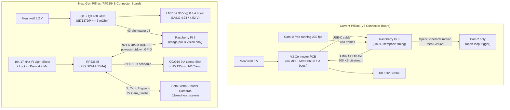

<!-- SPDX-License-Identifier: GPL-3.0-or-later -->
<!-- Copyright (C) 2026 PiTrac contributors -->

# Next Gen PiTrac vs. Current PiTrac

This document compares **Next Gen PiTrac** (the RP2354B controller & connector board in this repository) against the **Current PiTrac** release:

- **Current PiTrac hardware:** [`PiTracLM/PiTrac` — `Hardware/`](https://github.com/PiTracLM/PiTrac/tree/main/Hardware) (**V3 Connector Board** + **IRLED2**)
- **Current PiTrac documentation:** <https://docs.pitrac.org/>
- **Next Gen PiTrac sources of truth in this repo:** [`DEVELOPER_GUIDE.md`](DEVELOPER_GUIDE.md), netlist-generated [`HARDWARE_REFERENCE.md`](HARDWARE_REFERENCE.md), the [original hardware design doc](Hardware/The_One_Board_To_Rule_Them_All.md), and live bring-up status in [`Hardware/firmware/PROGRESS.md`](Hardware/firmware/PROGRESS.md) (§0 and §10).

---

## Contents

1. [Architectural Shift](#1-architectural-shift)
2. [Side-by-Side Comparison](#2-side-by-side-comparison)
3. [RP2354B ("Pico 2" Silicon) Deterministic Triggering](#3-rp2354b-pico-2-silicon-deterministic-triggering)
4. [Optical Light-Sheet ("Light Curtain") Trigger](#4-optical-light-sheet-light-curtain-trigger)
5. [Microphone and Audio Trigger Capability](#5-microphone-and-audio-trigger-capability)
6. [Improved Strobe Performance — Why?](#6-improved-strobe-performance--why)
7. [Simultaneous Dual-Camera Triggering for Single-Pi Stereo Vision](#7-simultaneous-dual-camera-triggering-for-single-pi-stereo-vision)
8. [Power Button and Safe Soft Shutdown of the Pi 5](#8-power-button-and-safe-soft-shutdown-of-the-pi-5)
9. [Pi 5 Brownout Resistance and No USB-C Power Cable](#9-pi-5-brownout-resistance-and-no-usb-c-power-cable)
10. [No USB Connection Needed After Initial RP2354B Setup](#10-no-usb-connection-needed-after-initial-rp2354b-setup)
11. [Other Notable Differences](#11-other-notable-differences)

---

## 1. Architectural Shift

Current PiTrac uses a **passive, all-through-hole analog interface board** (the **V3 Connector Board**) wired to the Raspberry Pi 5 over an 8-pin GPIO/SPI header (`J3`), a flying camera trigger wire (`GPIO25`), and an external USB-C power cable (`J2`/`J5`). All shot detection, shutter control, and strobe pulse generation happen inside Linux userspace (`pitrac_lm`).

PiTrac V2 replaces that entire arrangement with a **turnkey SMD real-time controller carrier board** built around an onboard **Raspberry Pi RP2354B** (`U3` — the 80-pin QFN, 48-GPIO, internal-2 MB-flash member of the Pico 2's RP2350 family). The Raspberry Pi 5 mounts directly on top of the 40-pin socket (`J8`) and is powered and supervised by the board.

> **Core design split ([`DEVELOPER_GUIDE.md`](DEVELOPER_GUIDE.md)):** *"The RP2354 owns everything with microsecond timing. The Pi owns everything with pixels."*

---

## 2. Side-by-Side Comparison

| Area | Current PiTrac | Next Gen PiTrac |
|---|---|---|
| **PCB & Assembly** | DIY hand-soldered **all-through-hole** PCB (`DIP-8`, `TO-92`, axial) + 8-pin Pi jumper header (`J3`) | Turnkey **JLCPCB SMD** controller board; Pi 5 seats directly onto 40-pin socket `J8` |
| **Timing Controller** | **None** — Raspberry Pi 5 Linux userspace (`lgpio` + `spidev` in `pulse_strobe.cpp`) | Onboard **RP2354B** (`150 MHz` Cortex-M33, 3 PIO blocks / 12 SMs, 12 PWM slices, 16 DMA channels) |
| **Ball Trigger & Pre-Shot Speed** | Camera 1 free-runs at `232 fps`; OpenCV detects motion *after* the ball leaves the tee (no pre-shot speed) | **104.17 kHz modulated IR light curtain** + synchronous lock-in demodulator + PIO transit timer measures ball speed *before* capture |
| **Audio Trigger** | None on V3 board (upstream `feature/pico` prototype uses an external I²S mic) | **Onboard analog MEMS mic** (`CMM-2718AT`, `250 ksps` on `ADC7`) **+ I²S digital mic header** (`J5`) |
| **Stereo Camera Triggering** | Single-Pi mode free-runs Cam 1 and triggers **only Cam 2** (`GPIO25`), open-loop; full stereo requires **two Pi 5s** | Triggers **both cameras simultaneously** (`D_Cam_Trigger`) and waits in PIO for **both** `Cam_Strobe` shutter-open signals on **one Pi 5** |
| **36 V Strobe Boost** | `MC33063AP` (`36 V @ 0.1 A`), single `330 µF` cap, no soft-start, no programmable UVLO | `LM5157` (`36 V @ 0.4 A`, ~1 MHz), **`2 × 330 µF` + `8 × 2.2 µF` MLCC bank**, `~86 ms` soft-start, hardware UVLO (`4.74 V / 4.52 V`) |
| **Strobe Current Drive** | `8-bit` `MCP4801` SPI DAC (`26` usable codes, `~0.38 A/step`) shifting an `LM317L` gate-driver supply rail; pulsed into `IRLU024N` gate | `10-bit` PWM DAC (`1024` levels) + ×3 amp holding linear sink **`Q9`** steady (`1 µF` gate-hold rework), switched by fast `12 V` series FET **`Q10`** (`~20 ns` rise) |
| **Strobe Pulse Timing** | Bit-banged `800 KB` buffer over Linux SPI `MOSI` (`~5 µs` bit steps; drifts with Pi clock scaling); static Driver/Putter arrays | **PIO0 SM0 + DMA** (`1.000 MHz` = exact `1 µs` steps, `< 0.1 µs` measured edge error); width and gap computed per shot from measured ball speed |
| **Strobe Safety & Sensing** | V3 removed the V2 555 timer (no hardware pulse clamp); slow SPI `MCP3202` ADC used only for static `DIAG` calibration | Hardware **`74LVC1G123` (`U5`) `~135 µs` pulse clamp** + **`500 ksps` `ADC0` DMA readback** checking every pulse's current and latching faults |
| **Pi Power & Shutdown** | Powered via external **USB-C cable** from V3 board (`J2`/`J5`); hard power-on/off with AC supply | Powered **directly via 40-pin header `J8`** (`5.2 V` through `≤ 3 mΩ` `SI7137DP` soft-latch `Q3`); panel button runs orderly `gpio-shutdown` + read-only mount check |
| **MCU Updates & Link** | N/A (or USB cable required for a separate Pico add-on) | **Zero USB needed after initial setup**: `921.6 kbaud` CRC-framed UART (`J8.8/10`) + **RAM-staged A/B partition OTA updates** from the Pi with hardware rollback |

---

## 3. RP2354B ("Pico 2" Silicon) Deterministic Triggering

### Why V1 Is Latency-Bound
In current PiTrac, `pitrac_lm` monitors a free-running `232 fps` video stream on Camera 1 (`~4.3 ms` frame period + MIPI CSI readout + Linux thread scheduling + OpenCV ball-motion detection). As documented on `docs.pitrac.org` (*Known Issues*), *"the time between when the ball is hit and when picture-taking/strobe-pulsing starts is too long — the ball has already moved halfway across the field of view."*

Once triggered, `pulse_strobe.cpp` toggles Camera 2's external shutter via userspace `lgGpioWrite` (`GPIO25`) and shifts an up-to-`800 KB` bit-stream out of Linux `lgSpiWrite` (`MOSI`) to create strobe pulses — a path whose actual pulse rate changes with Raspberry Pi core clock scaling unless `force_turbo = 1` is forced in `/boot/firmware/config.txt`.

### How V2 Solves It
V2 embeds an **RP2354B** directly on the controller board (providing 48 GPIOs and 3 PIO blocks vs. an RP2040 Pico's 30 GPIOs and 2 PIO blocks) and offloads every real-time signal onto dedicated silicon peripherals ([`Hardware/firmware/ARCHITECTURE.md`](Hardware/firmware/ARCHITECTURE.md)):

- **Comparator transit timing:** **PIO2 SM0** ([`detect.pio`](Hardware/firmware/src/detect.pio)) timestamps the ball crossing at `1 µs` resolution using an exact integer clock divider (`150 MHz / 75`) with zero ISR latency or flash-XIP stall risk.
- **Continuous pre-trigger analog history:** The `500 ksps` SAR ADC free-runs into a `32 KB` **ENDLESS-mode DMA ring** ([`adc_engine.c`](Hardware/firmware/src/adc_engine.c)) with zero CPU overhead.
- **Hardware-to-hardware camera → strobe handoff:** **PIO1 SM0** ([`cam_handshake.pio`](Hardware/firmware/src/cam_handshake.pio)) drives the camera trigger, samples both cameras' exposure-open outputs at `150 MHz`, and fires **PIO0 SM0** ([`strobe_burst.pio`](Hardware/firmware/src/strobe_burst.pio)) directly across PIO blocks via `irq prev set 4` with **no CPU instructions in the critical path**.
- **End-to-end detection latency:** `~30 µs` analog LPF group delay + `~1 µs` comparator response, eliminating milliseconds of frame-rate and OS jitter.

---

## 4. Optical Light-Sheet ("Light Curtain") Trigger

- **V1:** Has no optical trigger electronics; it requires visible non-IR COB LED strips to illuminate the teed ball for Camera 1, making low "worm-burner" trajectories and visually noisy hitting mats difficult to track.
- **Next Gen PiTrac ([original hardware design doc](Hardware/The_One_Board_To_Rule_Them_All.md) §4, [`HARDWARE_REFERENCE.md`](HARDWARE_REFERENCE.md) §5):** Projects a coincident vertical IR light sheet through an acrylic plano-convex cylindrical lens:
  - **Modulated transmitter:** `D11` (`VSMA1085250X02`) pulsed at `~3 A` peak on a fixed **`104.1667 kHz`** carrier (`GPIO31` PWM 7B, `25%` operating duty, hardware-clamped per cycle to `~122 µs` by `U9` `74LVC1G123`).
  - **TIA with active DC servo:** `D12` (`VBPW34FAS` photodiode, reverse-biased at `36 V` from `VIR` for low junction capacitance and fast speed) feeds `U11A` (`OPA4323` TIA) with a **`2.27 Hz` DC servo loop** (`U11B`/`U11D`) that nulls steady sunlight and room lighting before saturation.
  - **Synchronous lock-in demodulator:** `U13` (`TMUX1219`) + `U12A` sign-switches the carrier at `GPIO39` (PWM 11B, phase-locked to `GPIO31` within **`1.02 ns`** via a single atomic `PWM_EN` register write), followed by a 4th-order `15.39 kHz` Sallen-Key low-pass filter (`U12D`/`U12C`). Bench measurements ([`Hardware/firmware/PROGRESS.md`](Hardware/firmware/PROGRESS.md) §0.5) confirmed **`~48 dB` ambient rejection** at `120 Hz`.
  - **Gated baseline HPF:** `C81` + `U14` (`TMUX1219`, `GPIO33`) tracks slow thermal/ambient drift (`τ ≈ 0.66 s`) while idle (`TRACK`), then opens into a high-impedance **`HOLD`** while armed so even a slow `2 m/s` putt is not high-passed away.
  - **Immediate ball velocity:** Measuring transit time across the known optical curtain width (comparator edge timing refined against the `50 %` crossings of the `250 ksps` `ADC5` waveform) yields ball speed *before* the ball enters the flight-camera field of view.

---

## 5. Microphone and Audio Trigger Capability

Where Current PiTrac's V3 Connector Board has no audio hardware, Next Gen PiTrac provides two acoustic paths ([original hardware design doc](Hardware/The_One_Board_To_Rule_Them_All.md) §7):

1. **Onboard analog MEMS microphone (`U16` `CMM-2718AT` + `U17` `LMV321`):** Inverting band-pass stage (`~2.41–24 kHz`, gain `≈ −6.7`, biased at `1.65 V` on `GPIO47/ADC7`), powered from the always-on `+3.3VA` analog rail and sampled continuously at **`250 ksps`** alongside the optical detector while armed. Bench testing measured sub-LSB `0.5 mV` RMS noise and `51–54 dB` clap/snap SNR. It provides a precise club-strike timestamp and acoustic confirmation/veto to reject non-impact optical crossings (such as club waggles or practice swings).
2. **External digital I²S microphone header (`J5`):** 2×3 header (`GPIO4` SCK, `GPIO5` WS, `GPIO6` DATA via `220 Ω` series resistors, allocated to **PIO0 SM1**) for optional high-SNR digital acoustic capture.

---

## 6. Improved Strobe Performance — Why?

Comparing V1's V3 Connector Board schematics (`Power.kicad_sch`, `Strobe Generation.kicad_sch`, `DAC.kicad_sch`, `ADC.kicad_sch`) and `pulse_strobe.cpp` against V2's strobe subsystem ([`Hardware/firmware/BENCH_P6_STROBE.md`](Hardware/firmware/BENCH_P6_STROBE.md), [`strobe_plan.c`](Hardware/firmware/src/strobe_plan.c), [`strobe_live.c`](Hardware/firmware/src/strobe_live.c)) shows **five distinct electrical and timing improvements**:

### 1. 4× Boost Recharge Current and 2× Bulk Capacitor Energy Bank
- **V1:** Uses a `DIP-8` **`MC33063AP`** non-synchronous BJT boost converter rated at **`36 V @ 0.1 A` (`100 mA`)** feeding a **single `330 µF`** electrolytic (`C6`) + `1 µF` ceramic (`C5`). Across a multi-pulse `9–15 A` burst, `VIR` droops sharply and recharges slowly.
- **V2:** Uses a `~1 MHz` TI **`LM5157RTER`** boost converter (`4.7 µH`, `8.5 A` saturation inductor) delivering **`36 V @ 0.4 A` (`400 mA`)** into **`2 × 330 µF` electrolytics (`~600–660 µF` measured) + `8 × 2.2 µF` 50 V X7R ceramics**. Doubling bulk capacitance halves voltage sag (`ΔV = Q / C`) across a 10-pulse burst so late pulses maintain voltage headroom above the 5-LED string forward drop (`Vf`), while 4× average current recharges `VIR` four times faster.

### 2. Decoupled Cascode Current Sink (`Q9` + `Q10`) vs. Pulsed Variable Gate Supply
- **V1:** Shifts an `LM317L` regulator (`U2`) with an `8-bit` `MCP4801` SPI DAC (`U5`) that has **only `26` usable codes (`0x5A–0x74`, coarse `~0.38 A/count` resolution)**, using that variable `4.5–8 V` rail to power the `MCP1407` gate driver (`U3`). Every strobe pulse slews the power MOSFET (`IRLU024NPBF`) gate from `0 V` into its linear region.
- **V2:** Separates **"how much current"** from **"when to switch"** using two series FETs:
  - **Current regulation (`Q9` `IRLR2905`):** Driven by a **`10-bit` PWM DAC (`1024` levels → `~9.7 mV/step` at `TP3`)** + `LM358` ×3 amplifier (`0–9.9 V`), pre-settled at DC *before* the shot (with a bench-proven `1 µF` gate-hold capacitor per [`NEXT_BOARD_REV.md`](Hardware/firmware/NEXT_BOARD_REV.md) `CR-23` that eliminates turn-on overshoot).
  - **Pulse switching (`Q10` `AO3400A`):** Placed in series below `Q9` and snapped hard ON/OFF with a stiff **`12 V` gate driver (`U8` `MCP1416`)**.
  - **Bench result ([`PROGRESS.md`](Hardware/firmware/PROGRESS.md) §6):** **`~20 ns` current rise time**, flat current plateau within **`~100 ns`**, and **`0.3 %` repeatability at `9.02 A`** (with board/ADC scaling headroom up to 4 parallel strings / `18 A`).

### 3. Dynamic Per-Shot Speed Scheduling (Sharp `≤ 1 mm` Freeze Across All Clubs)
- **V1:** Pre-computes static `"fast"` (Driver) and `"slow"` (Putter) SPI byte buffers ahead of time because ball speed is unknown when the shutter opens.
- **V2:** Uses the measured light-curtain ball speed *v* on every shot ([`strobe_plan.c`](Hardware/firmware/src/strobe_plan.c)) to compute pulse width `w = 1.0 mm / v` (clamped `5–100 µs` so motion blur stays `≤ 1 mm`) and inter-pulse spacing `S / v` (`1–2` ball diameters), while automatically shedding pulses on slow putts to respect the `6.0 mC` per-burst capacitor-droop budget (`BURST_CHARGE_MAX_MC`).

### 4. Exact `1 µs` PIO Hardware Timing
- **V1:** Approximates pulse widths in `~5 µs` SPI bit multiples over Linux `spidev`.
- **V2:** Streams `(width_us, gap_us)` words via DMA into **PIO0 SM0** clocked at an integer-divided `1.000 MHz` (`150 MHz / 150`), bench-verified on a logic analyzer within **`< 0.1 µs`** on every pulse and gap.

### 5. `500 ksps` Per-Pulse Current Readback and Hardware Pulse-Width Watchdog
- **V1:** Removed the V2 Connector Board's 555 timer (leaving no hardware width limiter if software stalls) and shares its `MCP3202` ADC (`U6`) on the same SPI bus used to bit-bang strobes, restricting current readback to static `DIAG` calibration.
- **V2:** Protects every pulse with a non-defeatable **`U5` (`74LVC1G123`) hardware monostable clamp (`~135 µs` measured on Board 1; `GPIO27` permanently locked at `0` in [`safe_state.c`](Hardware/firmware/src/safe_state.c))** AND samples `ADC0` (`0.135 Ω` sense = `135 mV/A`) at **`500 ksps` via DMA** across every live firing — verifying pulse count, plateau current, and pulse shape, and immediately tripping `FAULT_STROBE_OVERCURRENT` (`> 10.8 A` plateau / `> 13 A` peak) or `FAULT_STROBE_CLAMP` on any anomaly.

---

## 7. Simultaneous Dual-Camera Triggering for Single-Pi Stereo Vision

- **Why V1 needed two Pi 5s for full stereo (`parts-list.md`):** Upstream docs note *"Only a single RPi5 is currently supported, however the path to stereoscopic vision currently requires two."* In single-Pi V1, Camera 1 must free-run continuously at `232 fps` to watch the teed ball, while only Camera 2 receives an external hardware trigger (`Pi GPIO25` → `Trig+`), and that trigger is open-loop (strobes begin without confirming shutter open).
- **How V2 achieves closed-loop stereo on a single Pi 5 ([`cam_handshake.pio`](Hardware/firmware/src/cam_handshake.pio)):**
  - Because the optical light curtain handles ball detection, **both global-shutter cameras on the Pi 5's dual CSI ports sit in external-trigger mode** during armed play.
  - Header `J4` drives **both cameras simultaneously from one net (`D_Cam_Trigger`, `GPIO10` on `J4.3` & `J4.4`)**.
  - **PIO1 SM0** samples **both cameras' exposure-active outputs (`Cam_Strobe_0` on `GPIO8` and `Cam_Strobe_1` on `GPIO9`) in a single coherent `150 MHz` clock cycle** (`mov isr, ~pins`), measures true trigger-to-exposure latency `t_cam` on every shot, and withholds the strobe `FIRE` signal until **both** shutters are simultaneously open (`max(first_delay, t_cam)`). If either camera fails to open within the timeout window, PIO1 drops the trigger and latches `CAM_TIMEOUT` without firing a single strobe pulse.

---

## 8. Power Button and Safe Soft Shutdown of the Pi 5

- **V1:** Has no power button or soft-latch; plugging in the Meanwell supply powers the Pi immediately, and turning it off requires Web UI / SSH access or pulling AC power.
- **V2 ([`power_fsm.c`](Hardware/firmware/src/power_fsm.c), [`Hardware/firmware/pi/README.md`](Hardware/firmware/pi/README.md)):** Separates `+5V_IN` (always-on `NCP1117` `+3V3` domain keeping the RP2354B alive at `~32 mA`) from switched `+5V` via high-side P-MOSFET soft-latch **`Q3` (`SI7137DP`, controlled by `GPIO15`)**:
  - **Power-on (short button press):** Verifies `+5V_IN ≥ 5.05 V`, closes `Q3` to power the Pi 5 on `J8`, verifies `PI_3V3_SENSE` (`GPIO24`), and enters `RUNNING` once Pi userspace systemd unit [`pitrac-rpi5-on.service`](Hardware/firmware/pi/pitrac-rpi5-on.service) drives `RPI5_ON` (`Pi GPIO22`) high.
  - **Orderly soft shutdown (short button press while running):** Disarms the beam and strobe, pulses `RPI5_SHUTDOWN` (`GPIO43` → `Pi GPIO26`) active-low for `200 ms` to invoke Linux's `dtoverlay=gpio-shutdown`, waits a minimum holdoff (`10 s` from firmware `1.3`; `15 s` in `1.1`/`1.2`), and opens `Q3` **only after** [`pitrac-rpi5-on-shutdown.sh`](Hardware/firmware/pi/pitrac-rpi5-on-shutdown.sh) checks `/proc/self/mountinfo` to confirm every block filesystem is remounted read-only and drops `GPIO22`.
  - **Failsafes:** Enforces a `60 s` shutdown timeout (`PI_SHUTDOWN_TIMEOUT`), logs power/halt history to flash (`hist`), and provides a **5-second button long-press escape hatch** to force-open `Q3` if the OS ever hangs.

---

## 9. Pi 5 Brownout Resistance and No USB-C Power Cable

### Why No USB-C Power Cable Is Needed
V1 routes `+5V` off the V3 Connector Board through USB-C receptacles (`J2`/`J5`) and a 1 ft USB-C cable into the Pi 5's USB-C port. V2 seats the Pi 5 directly onto **40-pin header `J8`**, feeding regulated **`5.2 V`** from screw terminal `J1` (`14 AWG` from the Meanwell `LRS-75-5`) through two **`≤ 3 mΩ` `SI7137DP` P-MOSFETs** (`Q1` reverse-polarity protection + `Q3` soft latch) straight into `J8` pins 2 and 4. *(While seated on `J8`, the Pi's own USB-C port must stay unplugged so it does not back-feed the switched `+5V` rail.)*

### Why Pi 5 Brownouts Are Dramatically Less Likely
1. **`5.2 V` source headroom + zero USB-C contact/cable drop:** Eliminating two USB-C connector pairs and a cable saves `~150–300 mV` of IR drop during `3–5 A` Pi 5 transient loads.
2. **Hardware UVLO on the `36 V` boost converter (`LM5157`):** Configured via `R3 = 12 kΩ / R4 = 5.6 kΩ` from `+5V` for **`4.74 V` turn-on / `4.52 V` turn-off**. Those thresholds are deliberately bracketed between the Pi 5's non-fatal brownout warning (`4.64 V`) and its fatal reset threshold (`4.2 V`): if heavy load drags `+5V` to `4.52 V`, the boost converter sheds itself automatically so the Pi 5 survives. By contrast, V1's `MC33063AP` operates down to `3.0 V` and continues drawing peak inductor current straight through a Pi crash.
3. **Controlled `~86 ms` boost soft-start (`C6 = 1 µF`):** Prevents `36 V` capacitor-charging inrush from slamming `+5V` at the instant the Pi 5 powers on.
4. **2× `VIR` bulk capacitance + `6.0 mC` firmware charge cap:** Buffers high-current strobe pulses on the `36 V` capacitor bank rather than pulling pulse peaks directly from `+5V` (and on ≥ `50 µs` `9 A` pulses, `LM5157` enters clean current-limit hiccup rather than collapsing `+5V`).
5. **Calibrated `ADC1` supply guards (`USB_POWER_ONLY` and `SUPPLY_LOST`):** Prevents `Q3` from ever closing on weak USB bench power (`< 5.05 V`, avoiding feeding a Pi 5 through `D8`'s `1 A` Schottky diode), checks load sag at `250 ms` (`4.60 V`), and monitors sustained rail droop (`< 4.90 V` with a `500 ms` debounce that rides through brief millisecond strobe dips while catching real supply loss).

---

## 10. No USB Connection Needed After Initial RP2354B Setup

- **One-time initial setup over USB-C (`J6`):** Flash the A/B partition table (`pitrac_pt.uf2`, [`Hardware/firmware/partition_table.json`](Hardware/firmware/partition_table.json)) and initial firmware (`≥ 1.1`), then run per-board bring-up calibration (`cfg save` stores a CRC32-protected 256-byte record in dual redundant 4 KB flash sectors at `0x1FE000` and `0x1FF000`, outside both firmware partitions).
- **Normal operation over `J8`:** Uses a **`921,600` baud CRC-16 framed binary UART protocol** ([`pi_link.c`](Hardware/firmware/src/pi_link.c), [`link_proto.h`](Hardware/firmware/src/link_proto.h)) over `J8` pins 8 and 10 (`/dev/ttyAMA0`) plus dedicated GPIO handshake lines — with UART pins electrically isolated unless the latch is closed, Pi `3.3 V` is present, and `RPI5_ON` is high so an idle-high TX line never back-feeds an unpowered Pi.
- **Self-hosted A/B firmware updates from the seated Pi ([`fw_update.c`](Hardware/firmware/src/fw_update.c), [`pitrac_link.py`](Hardware/firmware/pi/pitrac_link.py)):**
  - Because any RP2354B reset opens `Q3` and cuts power to the seated Pi 5, standard SWD or USB BOOTSEL flashing from that Pi would cut its own power mid-update.
  - Instead, running `pitrac-link update pitrac.bin` on the Pi streams the new image over UART into a **`288 KB` RAM staging buffer** on the RP2354B, verifies its SHA-256 and RP2350 Try-Before-You-Buy (`TBYB`) header without touching flash while the Pi runs, records a dual-CRC power-return note in retained RAM, **cleanly shuts down the Pi 5**, programs the inactive **A/B flash partition** in `STANDBY` (erasing sector 0 first and writing `IMAGE_DEF` last), and reboots into the new partition under the boot ROM's **`16.7 s` `TBYB` trial watchdog**.
  - Once the new firmware passes init self-checks, it calls `rom_explicit_buy()` and **automatically powers the Pi 5 back on**; if it crashes or hangs, the RP2350 boot ROM **automatically rolls back** to the previous partition and still restores Pi power. (Verified on Board 1 with a seated Pi 5 in [`BENCH_P8_PI.md`](Hardware/firmware/BENCH_P8_PI.md) §8.9.)
  - Firmware also compiles out the Pico SDK's `1200-baud` and `picotool -f` USB reset backdoors and blocks CLI `reset`/`bootsel` whenever a Pi is powered.

---

## 11. Other Notable Differences

- **Camera Upgrade Path and Direct V4L2 Raw Pipeline:** Current PiTrac uses `1456 × 1088` Sony **IMX296** global-shutter cameras through `libcamera`. V2 evaluates and supports the higher-resolution, NIR-enhanced **ams OSRAM Mira220 (`1600 × 1400` RAW8 @ `~89 fps`)** alongside the **IMX296 (`RAW10` @ `~60 fps`)** via direct **V4L2 / RP1 CFE raw capture** bypassing the Pi ISP ([`Software/camera-comparison/README.md`](Software/camera-comparison/README.md)), paired with a ChArUco lens-distortion calibration suite ([`Hardware/Calibration/README.md`](Hardware/Calibration/README.md)). *(Rev V1 hardware note `CR-09`: Mira220 trigger/strobe I/O is `1.8 V` non-`3.3 V`-tolerant, requiring an external `TXS0108E` level shifter on `J4` until folded into the next PCB revision.)*
- **Built-In Bench Instrumentation and Host Verification:** The RP2354B USB CLI ([`DEVELOPER_GUIDE.md`](DEVELOPER_GUIDE.md) Appendix A) includes a `500 ksps` triggered oscilloscope mode (`capture` + [`scope.py`](Hardware/firmware/tools/scope.py)) and reflector-free chopped-beam phase calibration (`cal demod`, `cal model`, `strobe cal`), backed by **273 native C host tests** (including cycle-accurate PIO simulation in [`pio_sim.c`](Hardware/firmware/tests/pio_sim.c) and the official RP2350 boot ROM scanner in [`rom_scan.c`](Hardware/firmware/tests/rom_scan.c)).
- **Reciprocal Hardware + Software Licensing ([`LICENSING.md`](LICENSING.md)):** Upstream `PiTracLM/PiTrac` C++ uses `GPL-2.0-only`; V2 pairs **CERN-OHL-S v2** for the KiCad hardware design with **GPL-3.0-or-later** for firmware, host tools, and Pi software.
- **Current Project Status ([`Hardware/firmware/PROGRESS.md`](Hardware/firmware/PROGRESS.md) §0 & §10):** Upstream V1 is a shipping end-to-end launch monitor with web dashboard and GSPro/E6 integration. V2 has bench-proven power/soft-shutdown + Pi UART OTA updates (Phase 8), carrier/lock-in optical ball detection (Phases 2–3), analog mic front-end (Phase 5), and `9 A` live strobing (Phase 6), with PIO dual-camera handshaking (Phase 7, firmware `1.5`/`1.7`) reviewed and ready for bench verification; connecting detected ball velocity into live shot sequencing and the UART shot-report link to `pitrac_lm` — plus next-spin PCB refinements tracked in [`Hardware/firmware/NEXT_BOARD_REV.md`](Hardware/firmware/NEXT_BOARD_REV.md) — are the remaining integration steps.
