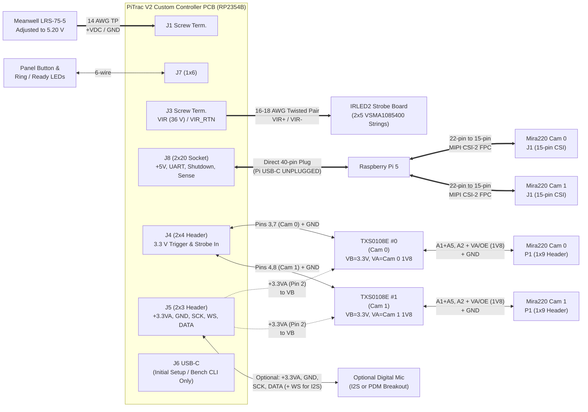

<!-- SPDX-License-Identifier: GPL-3.0-or-later -->
<!-- Copyright (C) 2026 PiTrac contributors -->

# Next Gen PiTrac — System Wiring Diagram and Pinout Guide

Complete harness and connector wiring guide for the **Next Gen PiTrac controller & connector board**, covering connections to:

1. **5.2 V Main Power (`J1`) and Optional Panel Switch/LEDs (`J7`)**
2. **External IRLED / IRLED2 Strobe Array Board (`J3`)**
3. **Raspberry Pi 5 (`J8` 40-pin socket + dual MIPI CSI-2 camera ribbons)**
4. **2 × ams-OSRAM Mira220 Camera Boards, each via its own HiLetgo `TXS0108E` Level Converter (`J4` + `J5.2`)**
5. **Optional External Digital Microphone (`J5`) — both I²S (3-wire) and PDM (2-wire)**

> **Sources verified against hardware netlists:**
> - Next Gen PiTrac KiCad netlist & PCB: [KiCad netlist](Hardware/The_One_Board_To_Rule_Them_All/exports/The_One_Board_To_Rule_Them_All.net), [`HARDWARE_REFERENCE.md`](HARDWARE_REFERENCE.md), [`DEVELOPER_GUIDE.md`](DEVELOPER_GUIDE.md) (§5.3)
> - Camera level-shifter safety rules: [`Hardware/firmware/BRINGUP_NEW_BOARD.md`](Hardware/firmware/BRINGUP_NEW_BOARD.md) (Step 13.4) and [`Hardware/firmware/NEXT_BOARD_REV.md`](Hardware/firmware/NEXT_BOARD_REV.md) (`CR-09`, `CR-27`)
> - ams-OSRAM Mira220 CSP Reference Design (`V2.2`): [`ams-OSRAM/ams-Mira-Image-Sensors` (`camera_board/Mira220`)](https://github.com/ams-OSRAM/ams-Mira-Image-Sensors/tree/main/camera_board/Mira220) (`MIRA220CSP-Sheet1.SchDoc`, `P1` / `J1` / `J2`)
> - Level converter breakout: HiLetgo `TXS0108E` 8-Channel Bi-Directional Logic Level Converter

---

## Contents

1. [Non-Negotiable Wiring Safety Rules](#1-non-negotiable-wiring-safety-rules)
2. [Whole-System Interconnect Overview](#2-whole-system-interconnect-overview)
3. [PiTrac V2 PCB Connector Summary (`J1`–`J9`)](#3-pitrac-v2-pcb-connector-summary-j1j9)
4. [Power Supply (`J1`) and Panel Controls (`J7`)](#4-power-supply-j1-and-panel-controls-j7)
5. [IRLED / IRLED2 Strobe Board Wiring (`J3`)](#5-irled--irled2-strobe-board-wiring-j3)
6. [Raspberry Pi 5 Wiring (`J8` + Dual MIPI CSI-2 Ribbons)](#6-raspberry-pi-5-wiring-j8--dual-mipi-csi-2-ribbons)
7. [Mira220 Cameras via `TXS0108E` Level Converter (`J4` + `J5.2`)](#7-mira220-cameras-via-txs0108e-level-converter-j4--j52)
8. [Optional External Digital Microphone (`J5`): I2S and PDM](#8-optional-external-digital-microphone-j5-i2s-and-pdm)
9. [Pre-Power Verification Checklist](#9-pre-power-verification-checklist)

---

## 1. Non-Negotiable Wiring Safety Rules

Read every item before stripping wire or seating a connector:

1. **Wire and re-seat ONLY while completely unpowered.** Both the **5.2 V PSU (`J1`)** and **USB-C (`J6`)** must be unplugged (USB-C alone keeps `+3V3` and `+3.3VA` live), and wait for `VIR` (`36 V`) bulk capacitors to discharge.
2. **NEVER wire `J4` directly to a Mira220 camera.** Mira220 digital I/O is `1.8 V` with **zero `3.3 V` tolerance** (`VIH(max) = VDD18 = 1.8 V`; `VOH = 1.44–1.80 V` vs. RP2354B `VIH ≈ 2.15 V`). Always go through the `TXS0108E` level converter (`CR-09`).
3. **Power each `TXS0108E`'s `VB` (`3.3 V`) from PCB `J5.2` (`+3.3VA`), NEVER from a camera's `3V3` pin.** The RP2354B can be powered while the Pi/cameras are off; tying `VB` to the camera's `3V3` back-powers an unpowered camera through the translator. Leave Mira220 `P1.2` (`3V3`) unconnected on both cameras.
4. **One `TXS0108E` per camera, each with `VA + OE` from its own camera's `P1.5` (`1V8`)** (owner, 2026-11-20). A camera's `1V8` is up only while it streams, so a module fed by the other camera would drive an unpowered camera's pins. Never tie two cameras' `1V8` LDO outputs together, and never put two cameras' `REQ EXP` (`P1.7`) `12 kΩ` pull-downs on one `A` pin (see [§7.2–§7.3](#72-one-txs0108e-per-camera)).
5. **NEVER plug a USB-C power supply into the Raspberry Pi 5 while it is seated on `J8`.** The Pi 5 receives all power from `J8` pins 2 & 4; plugging USB-C into the Pi back-feeds the board's switched `+5V` rail regardless of the latch state.
6. **Tape over `SW2` (`RUN` reset button) whenever a Pi 5 is seated on `J8`.** Resetting the RP2354B opens the `+5V` soft-latch (`Q3`), instantly hard-cutting power to the Pi 5.
7. **`J3.2` (`VIR_RTN`) and `TP5` (`Strobe_GND`) are NOT ground.** `J3.2` sits at the `36 V` LED bank cathode above linear sink `Q9`/`Q10`. Never tie `J3.2` to `GND` or clip an earth-grounded oscilloscope lead to it.
8. **Keep nothing conductive near photodiode `D12`.** Its cathode sits at **`36 V`** (`VIR` via `R77`).

---

## 2. Whole-System Interconnect Overview



---

## 3. PiTrac V2 PCB Connector Summary (`J1`–`J9`)

Every pin assignment below is extracted directly from the [KiCad netlist](Hardware/The_One_Board_To_Rule_Them_All/exports/The_One_Board_To_Rule_Them_All.net) and `.kicad_pcb`. Square pads denote **Pin 1** on headers `J2`, `J4`, `J5`, `J7`, and `J8`.

| Ref | Connector Type | Function | Normal Play State |
|---|---|---|---|
| **`J1`** | 2-pos screw terminal (`5.0 mm`) | `+5.20 V` main DC input (`+VDC`, `GND`) | Connected to Meanwell `LRS-75-5` |
| **`J2`** | `1×2` `2.54 mm` pin header | Soft-latch bypass jumper (forces `+5V` on) | **OPEN (no jumper)** — dead-board smoke test only |
| **`J3`** | 2-pos screw terminal (`5.0 mm`) | `36 V` strobe LED array (`VIR`, `VIR_RTN`) | Connected to `IRLED2` via twisted pair |
| **`J4`** | `2×4` `2.54 mm` pin header | Camera trigger out + 2× strobe feedback in (`3.3 V`) | Connected to the **B-side of two `TXS0108E` modules**, one per camera |
| **`J5`** | `2×3` `2.54 mm` pin header | `+3.3VA` supply (for `TXS0108E` `VB`) + optional digital mic | `J5.2` feeds both modules' `VB`; optional I²S/PDM mic |
| **`J6`** | USB Type-C receptacle | RP2354B native USB (`BOOTSEL` + CDC bench CLI) | Unplugged in standalone play (initial setup / bench only) |
| **`J7`** | `1×6` `2.54 mm` pin header | Panel momentary power button + ring & ready LEDs | Connected to enclosure panel button/LEDs |
| **`J8`** | `2×20` `2.54 mm` female socket | Raspberry Pi 5 power (`+5V`) + UART + GPIO handshake | Pi 5 plugged directly onto all 40 pins |
| **`J9`** | USB Type-A receptacle | Switched `+5V` accessory power (`GPIO32`) | Optional non-IR tee light strip (never powers Pi) |

---

## 4. Power Supply (`J1`) and Panel Controls (`J7`)

### 4.1 Main 5.2 V Supply (`J1`)

Adjust the Meanwell `LRS-75-5` output trim potentiometer to **`5.20 V`** using a DMM **before** connecting it to `J1` (a supply set to `5.00 V` can fall below the firmware's `5.05 V` `V5_MIN_FOR_LATCH` USB-power discriminator and refuse to turn on).

| Meanwell `LRS-75-5` | Wire | PiTrac V2 `J1` | Notes |
|---|---|---|---|
| **`+V`** (`5.20 V`) | `14–16 AWG` Red (twisted with Black) | **`J1.1`** (`+VDC`) | Reverse-polarity protected by `Q1` (`SI7137DP`). Use solid wire or narrow ferrules (`CR-06`) |
| **`-V`** (`0 V`) | `14–16 AWG` Black | **`J1.2`** (`GND`) | Main high-current return for Pi 5 + `36 V` boost + beam |

### 4.2 Optional Enclosure Panel Button & LEDs (`J7`, `1×6` Header)

`J7.1` has a **square pad**. `PWR_TOGGLE` (`J7.3`) uses the RP2354B's internal pull-up (`active-low`): a short press turns the system on or initiates an orderly Pi 5 soft shutdown; a **5-second hold** forces power off.

```
   PiTrac V2 J7 (1x6, 2.54 mm)
   +---+
 1 | # | +5V (switched rail -- LED common anode)
 2 | o | PWR_LED- (Q4 open-drain sink, PWM 5B / GPIO11)
 3 | o | PWR_TOGGLE (button input to GPIO14 via 1k; active-low to GND)
 4 | o | GND (button return)
 5 | o | +5V (switched rail -- LED common anode)
 6 | o | RDY_LED- (Q5 open-drain sink, SIO / GPIO12)
   +---+
```

| Enclosure Panel Component | Connects Across | Notes |
|---|---|---|
| **Momentary Power Button (NO)** | **`J7.3`** (`PWR_TOGGLE`) ↔ **`J7.4`** (`GND`) | Bezel switch contacts; `J7.5` next to `J7.4` is `+5V`, so insulate terminals cleanly |
| **Power Button Ring LED** | Anode (`+`) → **`J7.1`** (`+5V`), Cathode (`-`) → **`J7.2`** (`PWR_LED-`) | Onboard `R48` (`47 Ω`) already in series on PCB |
| **System Ready LED** | Anode (`+`) → **`J7.5`** (`+5V`), Cathode (`-`) → **`J7.6`** (`RDY_LED-`) | Onboard `R49` (`220 Ω`) already in series on PCB |

---

## 5. IRLED / IRLED2 Strobe Board Wiring (`J3`)

`J3` drives the external high-current IR strobe array (`IRLED2` PCB: `10 × Vishay VSMA1085400` in a `2`-string × `5`-series configuration, pulsed at `4.5 A` per string = **`9 A` total** from `36 V`; the controller supports up to `4` parallel strings).

The [emitter PCB](Hardware/IR_LED_Strobe/README.md) has 20 LED positions. On the current
assembly only the middle two rows (D6–D10 and D11–D15) are populated; the two outer rows are empty.

```
   PiTrac V2 J3                                IRLED2 Strobe PCB
  +------------+    16-18 AWG Tightly         +-----------------+
  |  J3.1  VIR |==============================| VIR+  (Anodes)  |
  |   (+36 V)  |    Twisted Pair (short)      |                 |
  |            |                              |  2x5 VSMA1085400|
  | J3.2       |==============================| VIR-  (Cathodes)|
  |  VIR_RTN   |                              +-----------------+
  +------------+
        |
   (Inside V2 PCB: Q9 IRLR2905 linear sink -> Q10 AO3400A switch -> 0.135 Ohm sense -> GND)
```

| PiTrac V2 `J3` | Net Name | Wire | `IRLED2` Board Pad | Critical Electrical Notes |
|---|---|---|---|---|
| **`J3.1`** | `VIR` | `16–18 AWG` Red (twisted) | **`VIR+`** | **`+36 V`** boost output backed by `2 × 330 µF` + MLCC bank |
| **`J3.2`** | `VIR_RTN` | `16–18 AWG` Black (twisted) | **`VIR-`** | **Switched current-sink return — NOT `GND`!** Connects to `Q9` drain; `D10` (`SS26`) clamps harness inductance across `J3.1`–`J3.2` |

- **Twist the pair tightly** along its full length: bench measurements ([`PROGRESS.md`](Hardware/firmware/PROGRESS.md) §6, 2026-10-13) showed twisting `J3` leads reduced fast edge spikes on `CurrentSense_ADC` by more than `2×`.
- **Inspect `J3` solder joints before first live run** (`CR-22`): `J3` sits on heavy copper pours that require adequate heat during hand-soldering.

---

## 6. Raspberry Pi 5 Wiring (`J8` + Dual MIPI CSI-2 Ribbons)

### 6.1 Direct 40-Pin Header Socket (`J8`)

The Raspberry Pi 5 mates **directly onto the `2×20` female socket `J8`** using all 40 pins (align Pi Pin 1 to `J8` **square Pad 1**). Do not wire `J8` with loose jumper leads — `J8` carries the Pi 5's full `3–5 A` `+5V` current and return grounds.

- **Pi 5 USB-C power port:** Leave **UNPLUGGED**.
- **PCB `SW2` (`RUN` button):** Cover with Kapton/electrical tape while the Pi is seated.
- **Required `/boot/firmware/config.txt` lines on the Pi 5** (installed via [`Hardware/firmware/pi/README.md`](Hardware/firmware/pi/README.md), with serial console removed from `cmdline.txt`):
  ```ini
  dtoverlay=gpio-shutdown,gpio_pin=26,active_low=1,gpio_pull=up
  dtparam=uart0=on
  ```

| `J8` Pin(s) | Pi 5 Pin / BCM GPIO | Net on PiTrac V2 PCB | Direction | Purpose |
|---|---|---|---|---|
| **`2, 4`** | `5V` power in | `+5V` (switched via `Q3`) | PCB → Pi | **Sole `5.2 V` power feed to the Raspberry Pi 5** |
| **`6, 9, 14, 20, 25, 30, 34, 39`** | `GND` | `GND` | Common | Power & signal ground returns |
| **`1`** *(note `17` below)* | `3V3` power out | `+3V3_Pi5` (`R45/R44` → `GPIO24`) | Pi → PCB | Pi 3.3 V rail presence sense (`J8.17` is unrouted on Rev V1 PCB per `CR-27`; `J8.1` carries it) |
| **`8`** | `GPIO14` (`TXD0`) | `Pi5_TX / Pico_Rx` (`220 Ω` → `GPIO37`) | Pi → PCB | `921,600` baud framed UART link (`pitrac-link` commands & OTA updates) |
| **`10`** | `GPIO15` (`RXD0`) | `Pi5_RX / Pico_TX` (`220 Ω` ← `GPIO36`) | PCB → Pi | `921,600` baud framed UART link (driven only when latch closed, `3V3` up, and `RPI5_ON` high) |
| **`11`** | `GPIO17` | `IRQ_OUT` (`1 kΩ` ← `GPIO3`) | PCB → Pi | Shot capture-complete interrupt pulse |
| **`13`** | `GPIO27` | `System_Ready` (`1 kΩ` ← `GPIO2`) | PCB → Pi | Armed-state mirror |
| **`15`** | `GPIO22` | `RPI5_ON` (`1 kΩ` → `GPIO0`) | Pi → PCB | Driven HIGH by `pitrac-rpi5-on.service` when up; dropped by shutdown hook once disks are read-only |
| **`16`** | `GPIO23` | `RPI5_RP2350_0` (`1 kΩ` ↔ `GPIO1`) | Bidir | Spare handshake 0 |
| **`18, 22`** | `GPIO24, GPIO25` | `SWD`, `SWCLK` (direct) | High-Z | RP2354B SWD pads — **leave Pi `GPIO24/25` unused as inputs** when seated (any SWD reset cuts Pi power) |
| **`36`** | `GPIO16` | `RPI5_RP2350_1` (`1 kΩ` ↔ `GPIO7`) | Bidir | Spare handshake 1 |
| **`37`** | `GPIO26` | `RPI5_SHUTDOWN` (`1 kΩ` ← `GPIO43`) | PCB → Pi | Active-low `200 ms` pulse requesting clean OS shutdown (`gpio-shutdown` overlay) |
| *All others* | I²C, SPI0, PCM, GP4–13, ID | Unconnected | — | Unused by PiTrac V2 PCB |

### 6.2 MIPI CSI-2 Ribbon Cables (Pi 5 ↔ Mira220 Cameras)

Each ams-OSRAM Mira220 board has a **15-pin `1.0 mm` pitch right-angle FPC connector (`J1`, TE `1-84952-5`)** on the back, whereas the Raspberry Pi 5 uses **22-pin `0.5 mm` pitch `CAM/DISP0` and `CAM/DISP1` FPC connectors**.

| Pi 5 Port | Cable Type | Camera Destination | What Travels Over the CSI Ribbon |
|---|---|---|---|
| **`CAM/DISP0`** (`22-pin`, `0.5 mm`) | Pi 5 Camera Adapter FPC (`22-pin 0.5 mm` ↔ `15-pin 1.0 mm`) | **One camera's `J1`** (`15-pin`, `1.0 mm`) | `3.3 V` camera power (`VDD33`), `GND`, `CCI I²C` (`SDA`/`SCK`), `CAM_ENABLE`, and 2-lane `MIPI CSI-2` raw image data |
| **`CAM/DISP1`** (`22-pin`, `0.5 mm`) | Pi 5 Camera Adapter FPC (`22-pin 0.5 mm` ↔ `15-pin 1.0 mm`) | **The other camera's `J1`** (`15-pin`, `1.0 mm`) | Same as above for the other camera |

> **Orientation check:** Verify silver contact-finger orientation against the locking-tab side of both the Pi 5 `CAM/DISP` sockets and Mira220 `J1` before inserting, with all power off ([`Software/camera-comparison/README.md`](Software/camera-comparison/README.md)). Because the CSI ribbon already supplies `VDD33`, `GND`, `SDA`, and `SCK` to each camera, **do not connect `3V3`, `SDA`, or `SCK` on the Mira220 GPIO header**.
>
> **Which port is which camera:** the board does not care. Cameras 0 and 1 are defined by the `J4` column (§7), and the Pi port only sets the camera's I²C bus. Two Mira220s need both overlays in `config.txt`: `dtoverlay=mira220-nir,cam0` and `dtoverlay=mira220-nir`. On board 1, camera 0 has been on `CAM/DISP1` since 7c.0, and camera 1 goes on `CAM/DISP0` (7c.2, which records which bus is which camera).

---

## 7. Mira220 Cameras via `TXS0108E` Level Converter (`J4` + `J5.2`)

### 7.1 Connector Pinouts on Both Ends

#### A. PiTrac V2 Camera Header `J4` (`2×4`, `2.54 mm`) and `+3.3VA` Tap `J5.2`

`J4` is a standard odd/even `2×4` header (`J4.1` has the **square pad**). Notice how the **odd column (`1, 3, 5, 7`)** groups Camera 0 and the **even column (`2, 4, 6, 8`)** groups Camera 1:

```
         PiTrac V2 J4 (2x4, 2.54 mm)
     Cam 0 (Odd)           Cam 1 (Even)
       +-----+-----+
   1   |  #  |  o  |   2     1 = GND               2 = GND
   3   |  o  |  o  |   4     3 = D_Cam_Trigger     4 = D_Cam_Trigger  (shared GPIO10 via R18 220R, 3.3 V)
   5   |  o  |  o  |   6     5 = GND               6 = GND
   7   |  o  |  o  |   8     7 = Cam_Strobe_0      8 = Cam_Strobe_1   (GPIO8 via R19 / GPIO9 via R24, 3.3 V)
       +-----+-----+
```

Because `J4` has no `3.3 V` pin on Rev V1 (`CR-09`), the `3.3 V` high-side reference (`VB`) for both `TXS0108E` level converters comes directly from **`J5.2` (`+3.3VA`)** — see `J5` diagram in [§8](#8-optional-external-digital-microphone-j5-i2s-and-pdm).

#### B. ams-OSRAM Mira220 Reference Board (`V2.2`) GPIO Header `P1` (`1×9`, `2.54 mm`)

Verified against `MIRA220CSP-Sheet1.SchDoc` (`P1`, Würth `61300911121`) and the front-side silkscreen. Looking at the front lens/sensor face of the Mira220 PCB, **`P1` runs vertically along the left edge**, with **Pin 1 (`GND`, square pad) at the bottom** and **Pin 9 (`READ TRIG`) at the top**:

```
   Mira220 Front View -- Left-Edge 1x9 Header P1 (2.54 mm)
   +---+
 9 | o | READ TRIG   (READ_TRIGGER out, ball J10)        -> NC
 8 | o | REQ FRAME   (REQ_FRAME in, ball G9, 12k to GND) -> NC (unless frame-trig mode used; see note)
 7 | o | REQ EXP     (REQ_EXP in, ball G8, 12k to GND)   -> 1.8 V Trigger IN  (from A1+A5 of its own module)
 6 | o | ILLUM TRIG  (ILLUM_TRIGGER out, ball H5)        -> 1.8 V Strobe OUT  (to A2 of its own module)
 5 | o | 1V8         (VDD18 out from U2 TCR2EF18LM LDO)  -> VA+OE of THIS camera's own module only
 4 | o | SCK         (CCI I2C clock)                     -> NC (on CSI ribbon)
 3 | o | SDA         (CCI I2C data)                      -> NC (on CSI ribbon)
 2 | o | 3V3         (VDD33)                             -> NC -- DO NOT CONNECT! (Step 13.4 / CR-09)
 1 | # | GND         (Square pad, bottom-left)           -> GND               (to TXS0108E GND / J4 GND)
   +---+
```

> **Why wire to `P1` (left `1×9` header) instead of `J2` (top `1×8` header)?**
> The top `1×8` Molex PicoBlade footprint (`J2`) breaks out `REQ_EXP` (`J2.8`), `ILLUM_TRIGGER` (`J2.7`), `VDD33` (`J2.3/4`), and `GND` (`J2.1/2`), **but omits `VDD18` (`1V8`)**, which `TXS0108E` requires on `VA`. Use `P1`.
>
> **Note on `REQ EXP` (`P1.7`) vs. `REQ FRAME` (`P1.8`):** On the Mira220 reference schematic (matching `J2.8`), external trigger uses **`REQ EXP` (`P1.7`)**, where the trigger pulse controls exposure start/duration (`cam_handshake.pio` holds `D_Cam_Trigger` high across the strobe burst). If your Pi camera register script instead configures internal sensor-timed exposure started by a rising frame pulse, move each module's `A1` one pin up to `REQ FRAME` (`P1.8`).

#### C. HiLetgo `TXS0108E` Breakout Module Pinout

Each 20-pin HiLetgo `TXS0108E` module has a **low-voltage `A` row (`1.2–3.6 V`)** and a **high-voltage `B` row (`1.65–5.5 V`)**, where **`VA <= VB` (`1.8 V <= 3.3 V`) is mandatory**:

```
        HiLetgo TXS0108E Breakout
     1.8 V Camera Side    3.3 V PCB Side
        +--------------+--------------+
        | VA  (VCCA)   | VB  (VCCB)   |
        | A1  <------> | B1           |
        | A2  <------> | B2           |
        | A3  <------> | B3           |
        | A4  <------> | B4           |
        | A5  <------> | B5           |
        | A6  <------> | B6           |
        | A7  <------> | B7           |
        | A8  <------> | B8           |
        | OE           | GND          |
        +--------------+--------------+
```

---

### 7.2 One `TXS0108E` per Camera

**Decided by the owner, 2026-11-20** ([`BENCH_P5_P7_MIC_CAMERA.md`](Hardware/firmware/BENCH_P5_P7_MIC_CAMERA.md) 7c.2). Each camera has its own module, powered on its `1.8 V` side by that camera. The two modules are wired alike; only the `J4` column differs.

**Why not one module for both:** a Mira220's `1V8` is up only while it streams (board 1, 7c.0: `VA` read `0 V` with the stream stopped). A single module fed from camera 0 would drive camera 1's `REQ EXP` and `ILLUM TRIG` pins whenever camera 0 streams and camera 1 does not, with camera 1 unpowered: the `CR-09` back-feed case. With a module per camera, an unpowered camera's module has `VA = OE = 0 V`, and its pins are `Hi-Z`.

```
  Next Gen PiTrac PCB                 TXS0108E #0 (camera 0)           Mira220 Camera 0 (P1)
 +------------------+                 +-------------------+            +----------------------+
 | J5.2 (+3.3VA) -------------------->| VB             VA |<--+--------| P1.5 (1V8 VDD18 Out) |
 |                  |                 |                OE |<--+        | P1.2 (3V3) = NC!     |
 | J4.3 (Trig_0) -----------+-------->| B1             A1 |---+------->| P1.7 (REQ EXP)       |
 |                  |       +-------->| B5             A5 |---+        |                      |
 | J4.7 (Strobe_0) <------------------| B2             A2 |<-----------| P1.6 (ILLUM TRIG)    |
 | J4.1, J4.5 (GND) ----------------->| GND               |----------->| P1.1 (GND, sq. pad)  |
 |                  |                 +-------------------+            +----------------------+
 |                  |                 TXS0108E #1 (camera 1)           Mira220 Camera 1 (P1)
 |                  |                 +-------------------+            +----------------------+
 | J5.2 (spliced) ------------------->| VB             VA |<--+--------| P1.5 (1V8 VDD18 Out) |
 |                  |                 |                OE |<--+        | P1.2 (3V3) = NC!     |
 | J4.4 (Trig_1) -----------+-------->| B1             A1 |---+------->| P1.7 (REQ EXP)       |
 |                  |       +-------->| B5             A5 |---+        |                      |
 | J4.8 (Strobe_1) <------------------| B2             A2 |<-----------| P1.6 (ILLUM TRIG)    |
 | J4.2, J4.6 (GND) ----------------->| GND               |----------->| P1.1 (GND, sq. pad)  |
 +------------------+                 +-------------------+            +----------------------+
   On both modules: B3, B4, B6..B8 and A3, A4, A6..A8 are left NC.
```

*(For a **single-camera** setup, fit module #0 only.)*

| Signal Function | Next Gen PCB Pin | `TXS0108E` Pin (that camera's module) | Mira220 `P1` Pin (Silkscreen) | Voltage Shift |
|---|---|---|---|---|
| **3.3 V High-Side Ref** | **`J5.2`** (`+3.3VA`), spliced to both modules | **`VB`** | *(None — leave both `P1.2` `3V3` **NC**)* | `3.3 V` ref |
| **1.8 V Low-Side Ref + Enable** | *(None)* | **`VA`** + **`OE`** (jumpered) | **That camera's own `P1.5`** (`1V8`) | `1.8 V` ref |
| **Cam 0 — Exposure Trigger** | **`J4.3`** (`D_Cam_Trigger`) | module #0 **`B1`** → **`A1`**, with **`B5`/`A5` bridged** onto it | Cam 0 **`P1.7`** (`REQ EXP`) | `3.3 V` → `1.8 V` |
| **Cam 0 — Exposure Strobe Monitor** | **`J4.7`** (`Cam_Strobe_0`) | module #0 **`B2`** ← **`A2`** | Cam 0 **`P1.6`** (`ILLUM TRIG`) | `1.8 V` → `3.3 V` |
| **Cam 1 — Exposure Trigger** | **`J4.4`** (`D_Cam_Trigger`) | module #1 **`B1`** → **`A1`**, with **`B5`/`A5` bridged** onto it | Cam 1 **`P1.7`** (`REQ EXP`) | `3.3 V` → `1.8 V` |
| **Cam 1 — Exposure Strobe Monitor** | **`J4.8`** (`Cam_Strobe_1`) | module #1 **`B2`** ← **`A2`** | Cam 1 **`P1.6`** (`ILLUM TRIG`) | `1.8 V` → `3.3 V` |
| **Ground Return** | **`J4.1`, `J4.5`** (module #0); **`J4.2`, `J4.6`** (module #1) | **`GND`** | that camera's **`P1.1`** (`GND`, sq. pad) | `0 V` |
| **Unused Channels** | Leave unconnected | `B3`, `B4`, `B6..B8` & `A3`, `A4`, `A6..A8` **NC** | — | Internal pull-ups hold quiet |

---

### 7.3 Four Electrical Rules for the `TXS0108E` Modules and the Mira220s

1. **Feed each module's `VA + OE` from its own camera's `P1.5` (`1V8`), and from nothing else:**
   - Each Mira220 board generates `1V8` with its own `U2` (`TCR2EF18LM`) linear regulator sequenced by `U4` (`LM3880MF-1AA`) from its CSI port's `CAM_ENABLE` line (`MIRA220CSP-Sheet1.SchDoc`, `mira220.c`). Never tie two LDO outputs together.
   - The driver powers a camera only while it streams, and for 1 s after (runtime PM; board 1, 7c.0). Its module is `Hi-Z` the rest of the time, so the cameras need no start or stop order.
2. **One camera per `A` pin (`A1` on each module):**
   - On the Mira220 schematic, `REQ_EXP` (`P1.7`) has an onboard **`R2 = 12 kΩ` pull-down resistor to `GND`**. Inside `TXS0108E`, after the ~10 ns rising-edge accelerator finishes, steady-state HIGH is held through an internal **`RPUA ≈ 4 kΩ` pull-up to `VA` (`1.80 V`)**. Driving **one** camera per channel gives $1.80\text{ V} \times \frac{12\text{ k}\Omega}{4\text{ k}\Omega + 12\text{ k}\Omega} \approx \mathbf{1.35\text{ V}}$ (above Mira220's $V_{\text{IH(min)}} = 0.7 \times 1.80\text{ V} = \mathbf{1.26\text{ V}}$). If two cameras' `12 kΩ` pull-downs (`6 kΩ` parallel) were wired to a single `A1` pin, the steady plateau would sag to $1.80\text{ V} \times \frac{6}{4 + 6} = \mathbf{1.08\text{ V} < 1.26\text{ V}}$ and fail!
   - **Bridge spare channel `B5/A5` onto `B1/A1` on each module.** That halves the effective `RPUA` (`~1.5 V` HIGH plateau). **Measured on board 1 (2026-11-18), without the bridge:** `1.277 V`, an effective `RPUA` near `4.9 kΩ`, only 17 mV above `VIH`. The `ILLUM TRIG` falling edges also coupled dips to `1.04 V` for ≤ 1 µs. With the bridge: `1.490 V`, and no dips. Keep the trigger and strobe leads apart ([`BENCH_P5_P7_MIC_CAMERA.md`](Hardware/firmware/BENCH_P5_P7_MIC_CAMERA.md) 7c.1).
3. **Tie `OE` to `VA` (`1.8 V`) on each module:**
   - That keeps the module's channels in `Hi-Z` isolation whenever its camera is unpowered (`VA = 0 V`), and enables translation once that camera's `1V8` comes up.
4. **Keep signal leads short (`< 10–15 cm`, bundled with `GND`):**
   - `TXS0108E` uses internal one-shot edge-rate accelerators that can ring or re-trigger on long, high-capacitance flying leads. Mount each breakout midway on short leads bundled with `GND`.

---

## 8. Optional External Digital Microphone (`J5`): I2S and PDM

PiTrac V2 already includes an **onboard analog MEMS microphone** (`U16` `CMM-2718AT` on `ADC7`), so `J5` is **optional**. When used, `J5` connects a `3.3 V` digital MEMS microphone breakout directly to **RP2354B `PIO0 SM1`** (`GPIO4`, `GPIO5`, `GPIO6`, each protected by an onboard `220 Ω` series resistor — **no level converter is needed on `J5`**).

> **Firmware note ([`DEVELOPER_GUIDE.md`](DEVELOPER_GUIDE.md) §4.4, §7.6):** `PIO0 SM1` (`GPIOBASE 0`) is reserved in hardware/pin allocation for `J5`, while the digital-mic PIO capture driver (I²S or PDM decimation) is currently planned/optional.

### 8.1 Physical `J5` Header Pinout (`2×3`, `2.54 mm`)

Verified from `.kicad_pcb` (`PinHeader_2x03_P2.54mm_Vertical`, **square Pad 1**):

```
         PiTrac V2 J5 (2x3, 2.54 mm)
      Odd Column         Even Column
       +-----+-----+
   1   |  #  |  o  |   2     1 = D_DATA (GPIO6 in, 220R)    2 = +3.3VA (always-on 3.3 V via FB1)
   3   |  o  |  o  |   4     3 = D_WS   (GPIO5 out, 220R)   4 = GND
   5   |  o  |  o  |   6     5 = D_SCK  (GPIO4 out, 220R)   6 = GND
       +-----+-----+
```

> **Sharing `J5.2` (`+3.3VA`) with the Camera Level Converter:**
> Because `J5.2` also supplies `VB` (`3.3 V`) to both camera level converters ([§7.2](#72-one-txs0108e-per-camera)), it is already split two ways; an external digital microphone makes a third lead. Combined current draw is `< 5 mA`, well within `+3.3VA`'s budget.

---

### 8.2 Option A — External **I2S** Digital Microphone Wiring (3-Wire Bus)

Compatible with standard `3.3 V` I²S MEMS microphone breakouts such as **Adafruit `SPH0645LM4H`**, **InvenSense `ICS-43434`**, or **`INMP441`**.

```
   PiTrac V2 J5 (2x3)                     3.3 V I2S Mic Breakout
  +------------------+                   +------------------------+
  | J5.2 (+3.3VA) ---+---(Y-to-TXS VB)-->| 3V / VDD (3.3 V)       |
  | J5.4 (GND) ------+------------------>| GND                    |
  | J5.5 (D_SCK) ----+------------------>| BCLK / SCK (Bit Clock) |
  | J5.3 (D_WS) -----+------------------>| LRCL / WS  (Word Sel.) |
  | J5.1 (D_DATA) <--+-------------------| DOUT / SD  (Data Out)  |
  | J5.6 (GND) ------+------------------>| SEL / L-R  (Left ch.)  |
  +------------------+                   +------------------------+
```

| PiTrac V2 `J5` Pin | RP2354B Pin | I²S Mic Breakout Pin | Signal Role |
|---|---|---|---|
| **`J5.2`** (`+3.3VA`) | — | **`3V` / `VDD`** | Clean analog-filtered `3.3 V` supply (Y-spliced with `TXS0108E` `VB`) |
| **`J5.4`** (`GND`) | — | **`GND`** | Supply & signal ground |
| **`J5.5`** (`D_SCK`) | `GPIO4` (out, `220 Ω`) | **`BCLK` / `SCK`** | I²S bit clock from `PIO0 SM1` (e.g., `3.072 MHz` for `48 kHz` × 64-bit frame) |
| **`J5.3`** (`D_WS`) | `GPIO5` (out, `220 Ω`) | **`LRCL` / `WS`** | Left/Right word-select frame clock (`48 kHz`) |
| **`J5.1`** (`D_DATA`) | `GPIO6` (in, `220 Ω`) | **`DOUT` / `SD`** | 24-bit / 18-bit PCM serial data into `PIO0 SM1` |
| **`J5.6`** (`GND`) | — | **`SEL` / `L/R`** | Straps mic to **Left channel** (`WS = 0`); tie to `+3.3VA` only if Right channel is desired |

*(Note: on `INMP441` breakouts, also tie `CHIPEN` to `3.3 V` if not already pulled high on the breakout PCB.)*

---

### 8.3 Option B — External **PDM** Digital Microphone Wiring (2-Wire Bus)

Compatible with standard `3.3 V` Pulse-Density Modulation (1-bit oversampled) MEMS microphone breakouts such as **Adafruit `MP34DT01-M` PDM Breakout**, **`SPH0641LU4H`**, or **`IM69D130`**.

Unlike I²S, **PDM has no Word-Select (`WS` / `LRCLK`) line** — it uses only a `1.0–3.25 MHz` clock (`CLK`) and a 1-bit data stream (`DAT`), so **`J5.3` (`D_WS`) is left unconnected (`NC`)**:

```
   PiTrac V2 J5 (2x3)                     3.3 V PDM Mic Breakout
  +------------------+                   +------------------------+
  | J5.2 (+3.3VA) ---+---(Y-to-TXS VB)-->| 3V / VDD (3.3 V)       |
  | J5.4 (GND) ------+------------------>| GND                    |
  | J5.5 (D_SCK) ----+------------------>| CLK        (PDM Clock) |
  | J5.3 (D_WS)      |   (leave NC)      |                        |
  | J5.1 (D_DATA) <--+-------------------| DAT / DOUT (1-bit PDM) |
  | J5.6 (GND) ------+------------------>| SEL / L-R  (Edge Sel.) |
  +------------------+                   +------------------------+
```

| PiTrac V2 `J5` Pin | RP2354B Pin | PDM Mic Breakout Pin | Signal Role |
|---|---|---|---|
| **`J5.2`** (`+3.3VA`) | — | **`3V` / `VDD`** | Clean `3.3 V` supply (Y-spliced with `TXS0108E` `VB`) |
| **`J5.4`** (`GND`) | — | **`GND`** | Supply & signal ground |
| **`J5.5`** (`D_SCK`) | `GPIO4` (out, `220 Ω`) | **`CLK`** | `1.0–3.072 MHz` PDM oversampling clock from `PIO0 SM1` |
| **`J5.1`** (`D_DATA`) | `GPIO6` (in, `220 Ω`) | **`DAT` / `DOUT`** | 1-bit oversampled PDM bitstream into `PIO0 SM1` |
| **`J5.3`** (`D_WS`) | `GPIO5` | **Unconnected (`NC`)** | Unused in PDM mode |
| **`J5.6`** (`GND`) | — | **`SEL` / `L/R`** | Do **not** leave floating unless pulled on the breakout: tying `SEL` to `GND` selects the Left/falling-edge clock phase |

---

## 9. Pre-Power Verification Checklist

Before energizing a newly wired assembly, verify every item in order ([`BRINGUP_NEW_BOARD.md`](Hardware/firmware/BRINGUP_NEW_BOARD.md) Step 13.4):

1. **DMM continuity & short checks (PSU and USB-C both unplugged):**
   - `J2` bypass jumper is **OFF (open)**.
   - No short between `+VDC` (`J1.1`) and `GND` (`J1.2`), between `VIR` (`J3.1`) and `VIR_RTN` (`J3.2`), or between `VIR_RTN` (`J3.2`) and `GND`.
   - Mira220 **`P1.2` (`3V3`) is NOT connected** to `TXS0108E` `VB` or `J5.2` on either camera.
   - Each module's **`VA + OE` connects only to its own camera's `P1.5` (`1V8`)**; the two cameras' `1V8` pins are never joined.
   - Module #0's `B1` (with `B5`) is on `J4.3` and its `B2` on `J4.7`; module #1's `B1` (with `B5`) is on `J4.4` and its `B2` on `J4.8`. Nothing joins `J4.7` and `J4.8`.
   - Raspberry Pi 5's own USB-C power port is **empty**, `J8` is aligned Pin 1 to Pin 1 across all 40 pins, and **`SW2` is taped over**.
2. **Power-supply set point (disconnected from `J1`):**
   - Power on the Meanwell `LRS-75-5` alone and verify **`5.20 V ± 0.03 V`** on a DMM; power it down and wait for it to bleed to `0 V` before landing `J1`.
3. **Level-converter dry check before plugging onto Mira220 `P1` (recommended first time):**
   - With each module wired to `J4`/`J5.2` on the B-side and `1.8 V` applied to its `VA + OE` (a bench reference, or its camera's `P1.5` + `GND`), trigger `cam trig` from the CLI (`J8` empty if bench-testing) and confirm each module's `A1` swings cleanly to **`1.8 V`** (`never 3.3 V`) before landing `A1`/`A2` onto its camera's `P1.7`/`P1.6`.
